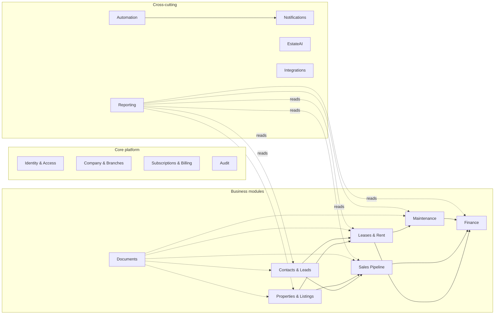
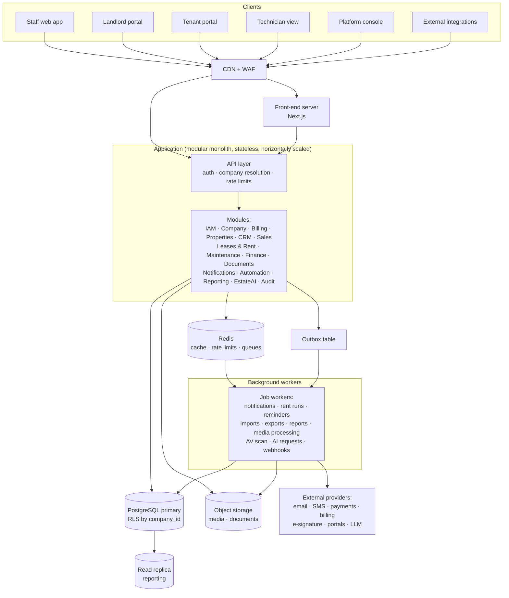
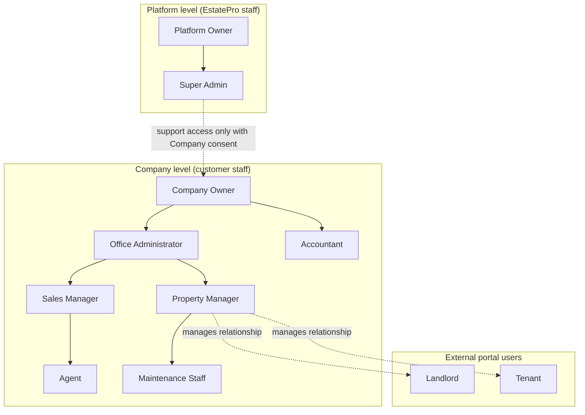
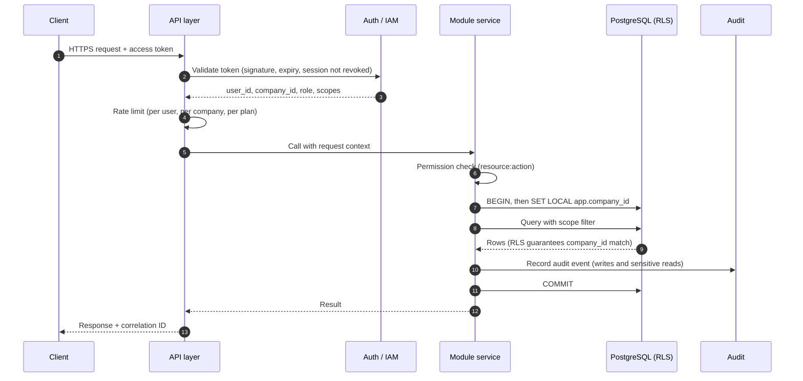
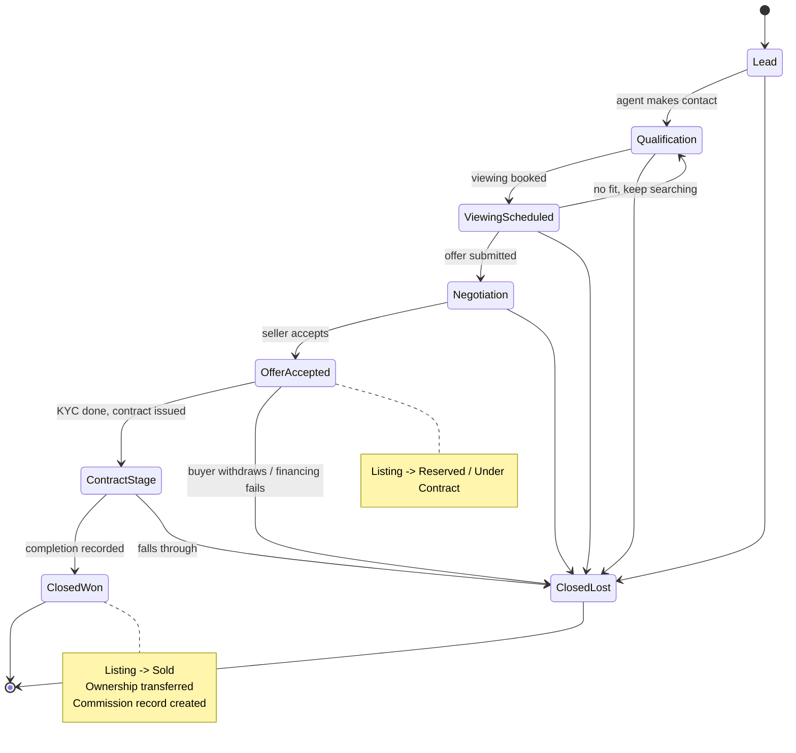
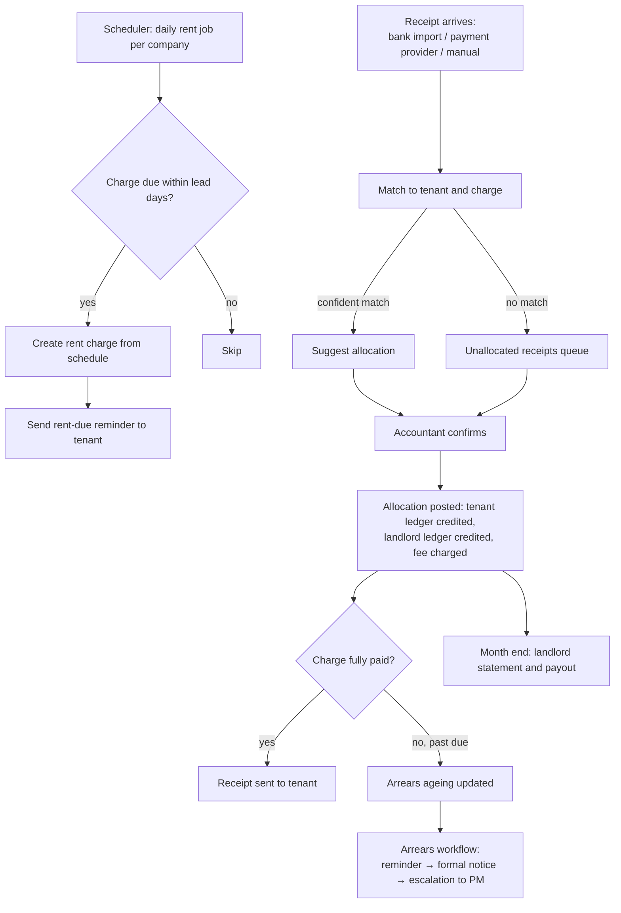
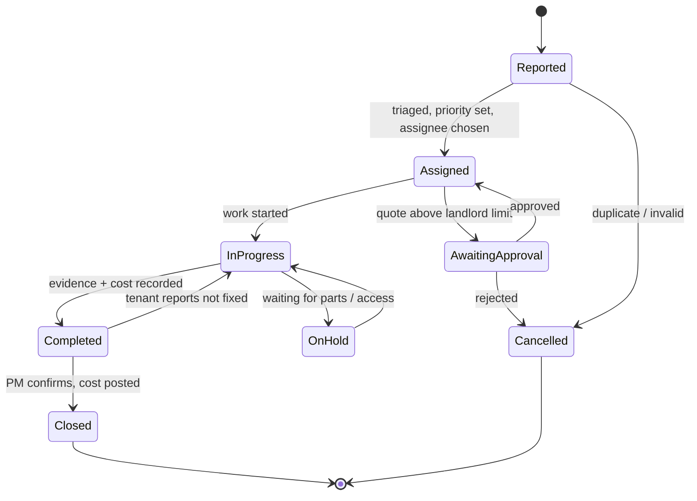
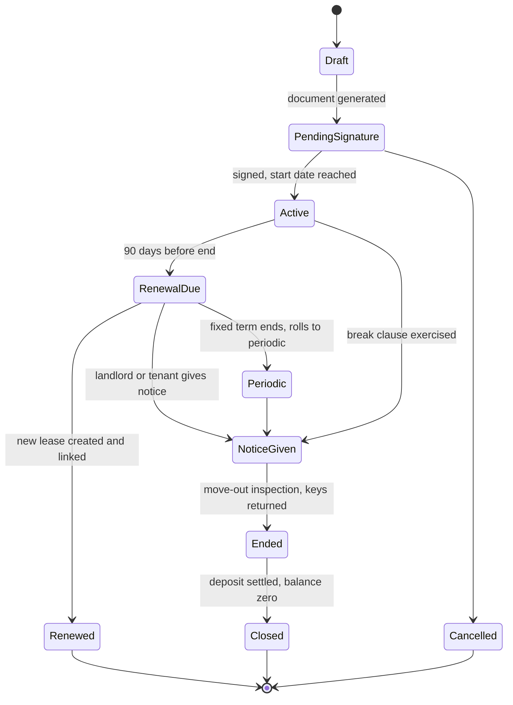
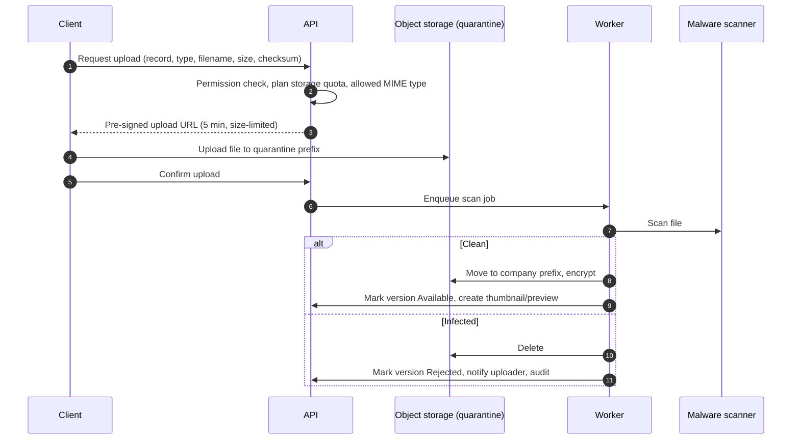
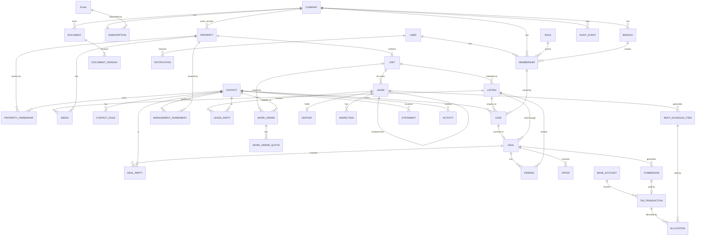

# EstatePro — Phase 1: Detailed Specification

| | |
|---|---|
| Document | Phase 1 of 16, detailed specification |
| Relationship | Supplements the [Phase 1 baseline](PHASE-1-PRODUCT-STRATEGY-ARCHITECTURE.md). Where they differ, the baseline names and the [Phase 2 schema](PHASE-2-DATABASE-ENGINEERING.md) are authoritative (see Phase 2 §13). |
| Status | Reviewed; open decisions resolved by the product owner (see §18.8) |
| Scope | Architecture only. No code is written in this phase. |
| Next phase | Phase 2: Database Engineering (complete) |

---

## Contents

1. [Platform Vision](#1-platform-vision)
2. [Business Objectives](#2-business-objectives)
3. [User Personas](#3-user-personas)
4. [Industry Pain Points](#4-industry-pain-points)
5. [Functional Requirements](#5-functional-requirements)
6. [Non-Functional Requirements](#6-non-functional-requirements)
7. [User Journey Mapping](#7-user-journey-mapping)
8. [Platform Structure](#8-platform-structure)
9. [SaaS Architecture Design](#9-saas-architecture-design)
10. [Role Hierarchy](#10-role-hierarchy)
11. [Permission Matrix](#11-permission-matrix)
12. [System Flow Diagrams](#12-system-flow-diagrams)
13. [Entity Relationship Model](#13-entity-relationship-model)
14. [Database Planning](#14-database-planning)
15. [Security Architecture](#15-security-architecture)
16. [Scalability Architecture](#16-scalability-architecture)
17. [API Architecture](#17-api-architecture)
18. [Phase 1 Close-out](#18-phase-1-close-out)

---

## 0. Terminology (read first)

The real estate domain and SaaS engineering both use the word "tenant" for different things. Mixing them up causes bugs and security incidents, so this project fixes the vocabulary now and uses it in every schema, API and UI label.

| Term | Meaning in EstatePro | Never use it for |
|---|---|---|
| **Company** | A paying SaaS customer (an agency, developer, management firm or landlord business). It is the isolation boundary for all data. In the database this is `company_id`. | — |
| **Tenant** | A person or organisation renting a unit under a lease. | The SaaS customer |
| **Branch** | An office or location inside a Company. Many agencies have several. Stored as `offices` in the schema. | — |
| **Contact** | Any person or organisation a Company deals with. One contact can hold several roles (buyer, seller, landlord, tenant, supplier). | — |
| **Property** | A physical asset: a building, house, plot or development. | A marketing advert |
| **Unit** | A lettable or sellable part of a property, such as an apartment in a block or a shop in a mall. A single house has exactly one unit. | — |
| **Listing** | One marketing campaign for one unit, for sale or for rent, with its own price, dates and status. A unit has many listings over its life. | The physical asset |
| **Deal** | A sales transaction in progress, from qualified enquiry to completion. | A lease |
| **Lease** | A rental agreement between a landlord (or the Company acting for them) and one or more tenants for a unit. | A deal |
| **Work Order** | A maintenance ticket. | — |
| **Platform** | EstatePro itself, operated by the Platform Owner. | — |

---

## 1. Platform Vision

EstatePro is the operating system for a property business. Agencies, developers, managers and landlords use it to run their listings, client relationships, sales, lettings, rent collection, maintenance, documents and the operational finance around them, in one auditable system.

### What EstatePro is

- A **system of record** for properties, contacts, deals, leases, money movements and documents.
- A **workflow tool** that moves work between people (agent, manager, accountant, contractor, landlord, tenant) with clear ownership and deadlines.
- A **portal** for external parties: landlords see their portfolio and statements, and tenants see their lease, rent balance and repair requests.
- **Multi-tenant SaaS**: each Company's data is strictly isolated, and the Company configures its own branches, users, roles, fees and templates.

### What EstatePro is not

- **Not a general ledger.** It tracks operational money (rent due and received, commissions, fees, property expenses, landlord payouts) and exports to accounting packages. It does not replace the Company's accountant or statutory books.
- **Not a property portal.** It publishes listings to the Company's website and to portals through feeds. It is not a consumer marketplace.
- **Not a payment processor.** It integrates with payment providers and banks, and records and reconciles their results.

### Product principles

1. **Records before features.** Every screen is backed by a correct, auditable record. Reports are computed from transactions and never typed in by hand.
2. **One contact, many roles.** A landlord who later buys a property is the same contact, with the same history.
3. **Ownership is explicit.** Every lead, deal, lease, ticket and task has exactly one responsible user and a due date where one applies.
4. **Configurable, not custom.** Statuses, fees, commission plans, templates and automations are configuration per Company. There are no per-customer code forks.
5. **Jurisdiction-aware.** Currency, tax, deposit rules, notice periods and required documents vary by country. They are configuration, not hard-coded rules.

---

## 2. Business Objectives

### 2.1 Commercial objectives

| # | Objective | Measure |
|---|---|---|
| B1 | Win small and mid-sized agencies (1–50 users) as the core segment | Paying Companies by plan; net revenue retention |
| B2 | Expand revenue per account through seats, managed-unit volume and plan upgrades | Average revenue per account; expansion revenue share |
| B3 | Keep churn low by becoming the system of record (money and documents live here) | Logo churn and revenue churn per month |
| B4 | Onboard without bespoke services | Time from sign-up to first live listing, and to first rent run |
| B5 | Serve enterprise accounts (developers, large management firms) without forking the product | Enterprise ARR; share of enterprise needs met by configuration |

### 2.2 Customer outcomes the product must deliver

| Outcome | How it is measured inside the product |
|---|---|
| Fewer missed rent payments, and arrears acted on sooner | Arrears ageing (0–30 / 31–60 / 61–90 / 90+ days); collection rate |
| Faster lead response | Median time from enquiry to first agent contact |
| No lease expires unnoticed | Leases expiring in 30/60/90 days with no renewal decision recorded |
| Repairs closed within agreed timescales | Work orders breaching SLA by priority |
| Accurate, prompt commission payment | Commission calculated at completion, approved and paid with an audit trail |
| Landlords trust the statements | Statement disputes; time to issue monthly statements |
| Compliance evidence is available on demand | Expired or missing compliance documents per property |

### 2.3 Revenue model (detailed in Phase 14)

- Subscription per Company on three plans: **Starter**, **Professional**, **Enterprise**.
- Pricing drivers: active users (seats), managed units, and storage.
- Paid add-ons: AI usage packs, extra storage, a dedicated database (Enterprise), SSO (Enterprise).
- Annual billing at a discount; monthly billing available.

---

## 3. User Personas

Each persona maps to one or more system roles (Section 10).

| Persona | Role(s) | Context | Primary goals | Frustrations today |
|---|---|---|---|---|
| **Ama, Agency Principal** | Company Owner | Owns a 3-branch agency with 25 staff | See pipeline, rent roll, cash and agent output at a glance; control costs; stay compliant | Data spread across spreadsheets, email and a separate accounting tool; no trusted numbers |
| **Daniel, Office Administrator** | Office Administrator | Runs a branch: users, templates, diaries, document filing | Keep records complete; set up staff quickly; chase missing documents | Re-keying the same data; staff leave and take client history with them |
| **Grace, Sales Agent** | Agent | Handles 40–80 active buyers and 15 listings | Respond to leads fast; book viewings; move deals forward; know her commission | Leads arrive through many channels and some are lost; no single client history |
| **Kwame, Sales Manager** | Sales Manager | Leads a team of 8 agents | Pipeline visibility, forecasting, lead distribution, coaching | Forecasts are guesses; stalled deals are found too late |
| **Esi, Property Manager** | Property Manager | Manages 250 units for 60 landlords | Rent collected, leases renewed, repairs done, landlords informed | Arrears tracked by hand; lease expiries missed; repair chasing by phone |
| **Michael, Accountant** | Accountant | Part-time or in-house, handles client money | Reconcile receipts, pay landlords and contractors, issue statements, calculate commissions | Manual reconciliation; disputes over fee deductions; no audit trail |
| **Mrs. Owusu, Landlord** | Landlord (portal) | Owns 4 flats managed by the agency | Know what was collected, what was spent and when she will be paid | Statements late or unclear; has to phone for updates |
| **Kofi, Tenant** | Tenant (portal) | Rents a 2-bed apartment | Pay rent, see balance and lease, report repairs and track them | No visibility after reporting a repair; disputes about payments |
| **Yaw, Maintenance Technician** | Maintenance Staff | In-house or contracted tradesperson | Clear job details, access arrangements, photos, a way to record work done | Incomplete job information; paperwork after every job |
| **Platform Support Engineer** | Super Admin | EstatePro staff | Resolve customer issues safely; manage plans and incidents | Needs access without breaching customer data |

---

## 4. Industry Pain Points

| Area | Pain point | Root cause | EstatePro response |
|---|---|---|---|
| Lead handling | Enquiries from portals, the website, phone and walk-ins are lost or answered late | No single intake; no ownership; no SLA | Unified lead inbox, source tracking, assignment rules, response-time alerts |
| Client data | Duplicate contacts; history leaves with the agent | Personal phones and spreadsheets | One contact record with multiple roles, dedupe on phone and email, full activity timeline owned by the Company |
| Listings | Inconsistent descriptions; outdated availability on portals | Manual copy-paste to each portal | Listing data held once, published by feed; status changes propagate |
| Sales progression | Deals stall between offer and completion with nobody chasing | No milestones or due dates | Pipeline stages with required steps, owners and stalled-deal alerts |
| Lettings | Lease expiries and rent reviews missed | Dates live in documents, not in a system | Leases as structured records; automated reminders at 90/60/30 days |
| Rent collection | Arrears discovered late; receipts not matched to tenants | Bank statements reconciled by hand | Rent schedule generated from the lease; receipt allocation; arrears ageing; reminders |
| Client money | Landlord statements are slow and disputed | Fees and expenses deducted ad hoc | Per-landlord ledger; fees from the management agreement; itemised statements |
| Maintenance | Tenants chase repairs; landlords dispute bills | No ticket trail, photos or approval step | Work orders with photos, priority SLAs, landlord approval limits, invoice attached |
| Commissions | Agents dispute commission; payouts are late | Splits agreed verbally | Commission plans, splits per deal, approval and payout tracking |
| Compliance | Expired safety certificates or missing KYC discovered at audit | Documents in shared drives without expiry dates | Typed documents with expiry dates, required-document checklists and alerts |
| Reporting | Owners cannot get trusted numbers | Numbers retyped into spreadsheets | Reports computed from transactions, with drill-down to source records |
| Access control | Ex-staff keep access; everyone can see everything | Shared logins; no roles | RBAC with data scopes, MFA, immediate deprovisioning, audit log |

---

## 5. Functional Requirements

Requirements carry IDs so later phases, tests and tickets can reference them. Priority: **M** = must, **S** = should, **C** = could (later release).

### 5.1 Platform & Company administration (ADM)

| ID | Requirement | Pri |
|---|---|---|
| ADM-01 | Self-service Company sign-up with email verification, creating the first Company Owner | M |
| ADM-02 | Company profile: legal name, registration number, tax ID, address, logo, default currency, timezone, locale, fiscal year start | M |
| ADM-03 | Branches with their own address, contact details and bank account for client money | M |
| ADM-04 | User invitation, role assignment, branch assignment, deactivation (immediately revokes sessions) | M |
| ADM-05 | Configurable picklists: property types, lead sources, expense categories, document types, lost-deal reasons | M |
| ADM-06 | Document and message templates with merge fields | M |
| ADM-07 | Platform console for the Platform Owner and Super Admin: Companies, plans, status (trial, active, past due, suspended, cancelled), usage | M |
| ADM-08 | Support access by platform staff only with time-boxed consent from the Company, fully audited | M |
| ADM-09 | Data export of all Company data (CSV/JSON plus documents) on request and at cancellation | M |
| ADM-10 | Custom fields on properties, contacts, deals and leases | S |

### 5.2 Property management (PRP)

| ID | Requirement | Pri |
|---|---|---|
| PRP-01 | Create, edit and archive properties, with type, category, address, geo-coordinates, year built, land size, tenure | M |
| PRP-02 | Units within a property: number, floor, bedrooms, bathrooms, floor area, parking, furnishing, features | M |
| PRP-03 | Ownership: one or more owner contacts per property with ownership percentage and effective dates | M |
| PRP-04 | Listings per unit for sale or rent: asking price or rent, rent frequency, availability date, description, status | M |
| PRP-05 | Listing statuses: Draft, Available, Reserved, Under Contract, Sold, Rented, Withdrawn. Unit operational flag: Under Maintenance (blocks new viewings and lettings) | M |
| PRP-06 | Media: photos (ordered, with cover image), videos (upload or external link), floor plans, virtual-tour links | M |
| PRP-07 | Internal notes, key and access information, and a status-history log. Notes have audiences (internal, landlord, tenant), revision history and their own permissions; tenant notes reference a unit; the key register tracks check-out and check-in (ADR-006) | M |
| PRP-08 | Location search: map view, radius and polygon search, filters by price, type, bedrooms and status. Radius up to 50 km, polygons up to 100 points, map results clustered above 500; locations are confirmed by a user, geocoding only suggests (ADR-006) | M |
| PRP-09 | Compliance documents per property or unit with expiry dates (e.g. safety certificates, insurance) | M |
| PRP-10 | Listing feed export to the Company website and portals, with a public location precision per listing: exact, approximate, area only or hidden (ADR-006) | S |
| PRP-11 | Developments: a project with phases, unit inventory, price lists and reservation tracking | S |

### 5.3 CRM (CRM)

| ID | Requirement | Pri |
|---|---|---|
| CRM-01 | Contacts (person or organisation) with roles: buyer, seller, landlord, tenant, supplier, other | M |
| CRM-02 | Duplicate detection on normalised phone and email; merge with history preserved | M |
| CRM-03 | Buyer and tenant requirements (budget, areas, type, bedrooms, move date) and matching against listings | M |
| CRM-04 | Activity timeline: calls, emails, SMS/WhatsApp logs, meetings, viewings, notes, documents and status changes | M |
| CRM-05 | Tasks and follow-ups with owner, due date and reminder | M |
| CRM-06 | Leads: source, campaign, enquiry listing, owner, status, response time | M |
| CRM-07 | Lead scoring by transparent rules (budget verified, mortgage in principle, timeframe, engagement). No opaque scores | S |
| CRM-08 | Consent and communication preferences per channel; record of lawful basis | M |
| CRM-09 | KYC/AML checks on sale parties: identity documents, verification status, reviewer | M |
| CRM-10 | Email integration (Microsoft 365, Google) to log correspondence | S |

### 5.4 Sales pipeline (SAL)

| ID | Requirement | Pri |
|---|---|---|
| SAL-01 | Deal stages: Lead → Qualification → Viewing Scheduled → Negotiation → Offer Accepted → Contract Stage → Closed Won; Closed Lost with a reason, from any stage | M |
| SAL-02 | Viewings: date, attendees, agent, feedback, outcome; calendar view; conflict detection | M |
| SAL-03 | Offers: amount, conditions, status (submitted, countered, accepted, rejected, withdrawn) and history | M |
| SAL-04 | Progression milestones after acceptance: deposit received, KYC complete, contract issued, contract signed, financing approved, completion date | M |
| SAL-05 | Agent assignment and reassignment with history; co-agent splits | M |
| SAL-06 | Pipeline board and list views by stage, agent, branch; stalled-deal flags | M |
| SAL-07 | Forecast: weighted pipeline value by expected close month, with stage probabilities configured per Company | M |
| SAL-08 | Commission calculated on completion from the agent's commission plan and deal splits | M |

### 5.5 Lettings, leases & rent (LET)

| ID | Requirement | Pri |
|---|---|---|
| LET-01 | Lease: unit, landlord(s), tenant(s), guarantor(s), start date, end date, type (fixed or periodic), rent, frequency, due day, deposit, notice period, break clause | M |
| LET-02 | Management agreement per landlord and property: service level (let-only, rent collection, fully managed), fee type and rate, expense approval limit | M |
| LET-03 | Rent schedule generated from the lease; supports pro-rated first period and rent changes | M |
| LET-04 | Recording receipts (manual, bank import, payment provider) and allocating them to charges | M |
| LET-05 | Arrears balance and ageing per tenant; arrears workflow (reminder, formal notice, escalation) | M |
| LET-06 | Deposits: amount, holder (agent, landlord, or external protection scheme), reference, return and deductions | M |
| LET-07 | Renewal workflow: renewal decision, new terms, new lease linked to the previous one; or notice and move-out | M |
| LET-08 | Rent reviews on a scheduled date with notification | M |
| LET-09 | Move-in and move-out inspections with condition reports and photos | M |
| LET-10 | Tenant portal: lease, documents, balance, payment history, receipts, repair requests | M |
| LET-11 | Landlord portal: properties, tenancies, statements, work orders awaiting approval, documents | M |
| LET-12 | Online rent payment through an integrated provider | S |

### 5.6 Maintenance (MNT)

| ID | Requirement | Pri |
|---|---|---|
| MNT-01 | Work order lifecycle: Reported → Triaged/Assigned → In Progress → Completed → Closed; plus On Hold and Cancelled | M |
| MNT-02 | Reported by tenant (portal), staff, or inspection; category, description, photos, access arrangements | M |
| MNT-03 | Priority with SLA targets (e.g. Emergency, Urgent, Routine), configured per Company | M |
| MNT-04 | Assignment to in-house staff or an external supplier contact | M |
| MNT-05 | Quotes and landlord approval when cost exceeds the management agreement's limit | M |
| MNT-06 | Completion evidence: notes, photos, time and materials, supplier invoice | M |
| MNT-07 | Cost recharged to the landlord ledger or absorbed, as configured | M |
| MNT-08 | Planned and recurring maintenance (e.g. annual servicing) | S |

### 5.7 Finance (FIN)

| ID | Requirement | Pri |
|---|---|---|
| FIN-01 | Operational transactions: rent receipts, fees, commissions, property expenses, landlord payouts, supplier payments, deposits | M |
| FIN-02 | Ledgers per landlord, tenant, property and Company (agency income) | M |
| FIN-03 | Landlord statements per period: rent collected, fees, expenses, payout | M |
| FIN-04 | Commission records: deal, agent, basis, amount, status (pending, approved, paid) | M |
| FIN-05 | Bank statement import (CSV/OFX) with matching suggestions and manual confirmation | M |
| FIN-06 | Tax on fees (VAT/GST/sales tax) by configurable rate | M |
| FIN-07 | Export to accounting systems (CSV first; Xero, QuickBooks and Sage connectors later) | S |
| FIN-08 | Period lock: closed periods cannot be edited; corrections are reversing entries | M |

### 5.8 Documents (DOC)

| ID | Requirement | Pri |
|---|---|---|
| DOC-01 | Upload documents linked to a property, unit, contact, deal, lease or work order, with a document type | M |
| DOC-02 | Version history; previous versions retained and viewable | M |
| DOC-03 | Access control by role and record scope; sharing with portal users is explicit per document | M |
| DOC-04 | Generate documents from templates (lease, offer letter, statements, notices) | M |
| DOC-05 | Expiry dates and required-document checklists per record type | M |
| DOC-06 | Malware scanning before a document becomes available | M |
| DOC-07 | E-signature integration | S |

### 5.9 Reporting (RPT)

| ID | Requirement | Pri |
|---|---|---|
| RPT-01 | Standard reports: occupancy and vacancy, rent roll, arrears ageing, lease expiries, sales pipeline and conversion, agent performance, maintenance SLA, landlord income, agency income, commissions | M |
| RPT-02 | Filters by date range, branch, agent, property and landlord; export to CSV, XLSX and PDF | M |
| RPT-03 | Drill-down from every figure to its source records | M |
| RPT-04 | Scheduled report delivery by email | S |

### 5.10 Automation & notifications (AUT)

| ID | Requirement | Pri |
|---|---|---|
| AUT-01 | In-app, email and SMS notifications with per-user preferences | M |
| AUT-02 | Built-in reminders: lease expiry, rent due, rent overdue, follow-up due, viewing reminder, document expiry, work-order SLA breach | M |
| AUT-03 | Company-configurable rules: trigger, conditions, actions (create task, send message, notify user, change field) with an execution log | S |

### 5.11 AI assistant: EstateAI (AI)

| ID | Requirement | Pri |
|---|---|---|
| AI-01 | Draft a listing description from the structured property data; the agent edits and approves it | S |
| AI-02 | Listing improvement suggestions (missing details, photo coverage, readability) | C |
| AI-03 | Draft lead follow-up messages from the lead's history | S |
| AI-04 | Market summary from the Company's own listing and transaction data for an area | C |
| AI-05 | Summarise long work-order threads | C |
| AI-06 | All AI output is a draft that needs human approval; no AI action changes records on its own | M |

### 5.12 Subscriptions & billing (BIL)

| ID | Requirement | Pri |
|---|---|---|
| BIL-01 | Plans with feature entitlements and usage limits (users, units, storage, AI credits) | M |
| BIL-02 | Trial, upgrade, downgrade, cancel; proration through the billing provider | M |
| BIL-03 | Dunning: past-due grace period, then read-only, then suspension; data is never deleted during dunning | M |
| BIL-04 | Invoices and receipts available to the Company Owner | M |

---

## 6. Non-Functional Requirements

| Category | Requirement | Target |
|---|---|---|
| Availability | Monthly uptime of the core application and API | 99.9% (Enterprise SLA 99.95%) |
| Performance | Interactive API reads (single record, list page) | p95 < 300 ms, p99 < 800 ms |
| | Interactive writes | p95 < 500 ms |
| | Search with filters on 100k listings per Company | p95 < 1 s |
| | Standard reports | < 5 s for interactive; heavier ones run asynchronously with a notification |
| | First meaningful paint on mid-range mobile over 4G | < 2.5 s |
| Capacity (initial design point) | Companies | 5,000 |
| | Units per large Company | 50,000 |
| | Concurrent active users | 10,000 |
| Data durability | Recovery point objective (RPO) | ≤ 15 minutes (point-in-time recovery) |
| | Recovery time objective (RTO) | ≤ 4 hours for a full region failure; ≤ 1 hour for a database instance failure |
| Security | Tenant isolation | Enforced in the database (row-level security) and the application layer |
| | Encryption | TLS 1.2+ in transit; AES-256 at rest; field-level encryption for sensitive personal and banking data |
| | Authentication | MFA available to all users; mandatory for Company Owner, Office Administrator and Accountant roles and for all platform staff |
| Privacy | Data protection | Supports GDPR-style rights: access, rectification, erasure (subject to legal retention), export; data residency per region |
| Auditability | Audit log | Every create, update, delete, export, login and permission change; append-only; retained at least 7 years for financial records |
| Accessibility | UI | WCAG 2.1 AA |
| Browser support | | Latest two versions of Chrome, Edge, Safari and Firefox; iOS Safari and Android Chrome |
| Localisation | | Multi-currency per Company; locale-aware dates, numbers and addresses; UI strings externalised for translation |
| Maintainability | | Modular codebase with enforced module boundaries; ≥ 80% coverage on domain logic; every API change is documented in OpenAPI |
| Observability | | Structured logs, metrics and traces with a correlation ID on every request; tenant-tagged telemetry |
| Operability | | Zero-downtime deploys; backward-compatible database migrations (expand/contract) |

---

## 7. User Journey Mapping

Each journey lists the steps, the system touchpoints, and the controls that make it reliable.

### 7.1 Sale: from instruction to commission paid

| # | Step | Actor | System touchpoint | Control |
|---|---|---|---|---|
| 1 | Seller instructs the agency | Agent | Create property, unit, seller contact and ownership; upload the agency agreement | Required-document checklist |
| 2 | Seller KYC | Agent, Office Admin | KYC record with ID documents | Listing cannot go live until KYC is verified (configurable) |
| 3 | Prepare listing | Agent | Photos, floor plan, description (optionally an EstateAI draft), price | Listing quality checklist |
| 4 | Publish | Agent | Status → Available; feed to the website and portals | Status-history log |
| 5 | Enquiries arrive | System | Lead created with source and listing; auto-assigned | Response-time SLA alert |
| 6 | Qualify buyer | Agent | Requirements, budget, financing status; deal at Qualification | Lead score rules |
| 7 | Viewing | Agent | Viewing booked; reminders to both parties; feedback captured | Calendar conflict check |
| 8 | Offer and negotiation | Agent | Offers recorded; seller response; deal at Negotiation | Offer history is immutable |
| 9 | Offer accepted | Agent | Deal → Offer Accepted; listing → Reserved / Under Contract; buyer KYC | Other offers notified as configured |
| 10 | Contract stage | Agent, Office Admin | Milestones tracked; contract documents versioned | Stalled-milestone alert |
| 11 | Completion | Agent | Deal → Closed Won; listing → Sold; ownership transferred | Commission record created |
| 12 | Commission | Sales Manager, Accountant | Commission approved, invoiced to the seller, paid to the agent | Approval required; audit trail |

### 7.2 Letting and management: from vacancy to renewal

| # | Step | Actor | Touchpoint | Control |
|---|---|---|---|---|
| 1 | Landlord signs a management agreement | Property Manager | Landlord contact, agreement (service level, fee, approval limit) | Agreement required before rent collection |
| 2 | Market the unit | Agent / PM | Rental listing → Available | — |
| 3 | Applicant chosen | PM | Applicant contact; references and checks recorded | Required checks list |
| 4 | Lease created | PM | Lease record; document generated from a template; e-signature | Lease cannot activate without signed document (configurable) |
| 5 | Deposit and first rent | Accountant | Receipts allocated; deposit registered with holder and reference | Deposit protection deadline reminder |
| 6 | Move-in | PM | Inspection report with photos; keys logged; listing → Rented | — |
| 7 | Monthly rent cycle | System, Accountant | Charges generated; reminders; receipts allocated; arrears flagged | Arrears ageing |
| 8 | Landlord statement and payout | Accountant | Statement generated; fees and expenses deducted; payout recorded | Period lock after issue |
| 9 | Repairs during tenancy | Tenant, PM, Technician | Work orders (see 7.3) | SLA |
| 10 | Renewal window (90/60/30 days) | System, PM | Renewal task; landlord and tenant consulted; decision recorded | Escalation if no decision by 30 days |
| 11a | Renew | PM | New lease linked to old; rent review applied | — |
| 11b | End | PM | Notice recorded; move-out inspection; deposit return with itemised deductions; rental relisted as a new listing (ADR-004 D3) | Deposit return deadline |

### 7.3 Maintenance: from report to close

| # | Step | Actor | Touchpoint | Control |
|---|---|---|---|---|
| 1 | Tenant reports an issue | Tenant | Portal form: category, description, photos, access availability | Emergency guidance shown for emergency categories |
| 2 | Triage | PM | Priority set (drives the SLA); duplicate check | SLA clock starts |
| 3 | Assign | PM | In-house technician or supplier | Supplier insurance must be valid |
| 4 | Quote and approval | Supplier, Landlord | Quote attached; landlord approves in the portal if above the limit | Work cannot start without approval above the limit |
| 5 | Work | Technician | Status → In Progress; notes and photos | — |
| 6 | Complete | Technician | Completion evidence; invoice | — |
| 7 | Confirm and close | PM, Tenant | Tenant confirmation (optional); cost posted to the landlord ledger; Closed | Cannot close without cost recorded or marked nil |

### 7.4 Month-end for the Accountant

1. Import bank statements for each client-money account.
2. Confirm suggested matches; allocate unmatched receipts manually or hold them as unallocated.
3. Review the arrears ageing report and approve escalations.
4. Generate landlord statements; review exceptions (negative balances, held funds).
5. Record payouts to landlords and suppliers; export the payment file.
6. Approve commissions for deals completed in the period.
7. Lock the period. Later corrections are reversing entries in an open period.
8. Export journals to the accounting package.

### 7.5 Company onboarding

1. Sign up and verify email → Company created in Trial.
2. Wizard: company details, currency, timezone, branches, logo.
3. Invite users and assign roles.
4. Import data from CSV templates: contacts, properties and units, active leases with balances.
5. Configure fees, commission plans, document templates and reminder rules (sensible defaults provided).
6. Connect integrations (email, portals, payment provider) as needed.
7. Choose a plan and enter billing details before the trial ends.

---

## 8. Platform Structure

### 8.1 Applications

| Application | Users | Purpose |
|---|---|---|
| **Staff web app** | Company staff roles | Main workspace. Responsive for desktop, tablet and mobile. |
| **Landlord portal** | Landlords | Portfolio, statements, approvals, documents |
| **Tenant portal** | Tenants | Lease, balance, payments, repairs, documents |
| **Technician view** | Maintenance Staff, suppliers | Mobile-first job list, job detail, completion capture |
| **Platform console** | Platform Owner, Super Admin | Companies, plans, usage, support access, incidents |
| **Public API & webhooks** | Integrations | Programmatic access for Professional and Enterprise plans |

All five front ends are served from one front-end codebase with separate route groups and layouts, to share the design system and API client.

### 8.2 Functional modules (bounded contexts)

| Module | Owns these records | Depends on |
|---|---|---|
| Identity & Access | users, memberships, roles, permissions, sessions, MFA factors, API keys | Company |
| Company & Branches | companies, branches, settings, picklists, custom field definitions | — |
| Subscriptions & Billing | plans, subscriptions, entitlements, usage counters, invoices (mirror of provider) | Company |
| Properties & Listings | properties, units, ownerships, listings, media, features, notes, status history | Contacts |
| Contacts & Leads | contacts, contact roles, requirements, leads, activities, tasks, consents, KYC checks | — |
| Sales Pipeline | deals, deal parties, viewings, offers, milestones | Properties, Contacts |
| Leases & Rent | management agreements, leases, lease parties, rent schedules, charges, deposits, inspections | Properties, Contacts |
| Maintenance | work orders, quotes, assignments, SLA policies | Properties, Leases, Contacts |
| Finance | bank accounts, transactions, allocations, ledgers, statements, commissions, payouts, periods | Leases, Sales, Maintenance |
| Documents | documents, versions, shares, templates | All (attaches to any record) |
| Notifications | notifications, preferences, delivery log | Identity |
| Automation | rules, scheduled jobs, execution log | All (through events) |
| Reporting | read models and report definitions | All (read-only) |
| EstateAI | prompts, generation requests, usage | Properties, Contacts, Maintenance (read-only) |
| Audit | audit events | All |

**Module rule:** a module writes only its own tables. Other modules read through its service interface or react to its domain events. This keeps the code maintainable and lets a module be extracted into its own service later without rewriting callers.

### 8.3 Staff app navigation (top level)

Dashboard · Properties · Listings · Contacts · Leads · Deals · Viewings · Leases · Rent & Arrears · Maintenance · Finance · Documents · Reports · Tasks · Settings

The full navigation hierarchy, dashboard layouts and screen inventory are designed in Phase 3.

---

## 9. SaaS Architecture Design

### 9.1 Architectural style: modular monolith first

EstatePro starts as a **modular monolith**: one deployable back-end application with strictly separated modules (Section 8.2), one primary PostgreSQL database, and separate worker processes for background jobs.

Why not microservices on day one:

- The domain is transactional and highly relational. Rent receipts, ledgers and statements must be consistent, and local database transactions are far simpler and safer than distributed sagas.
- A small team can ship and operate one deployable with far less overhead.
- Module boundaries enforced in code (and in tests) keep the option to extract services later. The first likely candidates are Notifications, Document processing, Reporting and EstateAI, because they are asynchronous and stateless.

### 9.2 Recommended technology stack

The stack is chosen for maturity, hiring pool, and long-term support. It is a recommendation to confirm before Phase 4, when application code begins.

| Layer | Choice | Reason |
|---|---|---|
| Back-end language & framework | TypeScript on Node.js LTS, with NestJS | Typed end to end with the front end; modular structure maps to bounded contexts; large hiring pool |
| Database | PostgreSQL 16+ (managed) with PostGIS | Strong transactions, row-level security for tenant isolation, JSONB for custom fields, geo search |
| Cache, rate limiting, queues | Redis (managed) with BullMQ | Proven job queue with retries, scheduling and rate limits |
| Search | PostgreSQL full-text search and PostGIS initially; OpenSearch when needed | Avoids a second datastore until volume requires it |
| Object storage | S3-compatible storage with a CDN | Media and documents; private by default; pre-signed URLs |
| Front end | React with Next.js, TypeScript | Mature ecosystem; server rendering for portals; shared component library |
| Auth | In-house auth module on proven libraries (Argon2id, WebAuthn, TOTP), with OIDC/SAML SSO for Enterprise | Full control over multi-company memberships and portal identities |
| Payments (subscription) | Stripe Billing or equivalent | Proration, dunning and invoices handled by the provider; no card data stored by EstatePro |
| Payments (rent) | Pluggable provider per region | Rent collection methods vary by country |
| Email / SMS | Transactional email provider; SMS/WhatsApp provider | Per-region providers behind one interface |
| Infrastructure | Containers on a managed orchestrator (e.g. AWS ECS Fargate or Kubernetes), infrastructure as code (Terraform) | Repeatable environments; regional deployment |
| Observability | OpenTelemetry → managed logs, metrics and traces; error tracking | Vendor-neutral instrumentation |

### 9.3 Logical architecture

### 9.4 Multi-tenancy model

| Option | Description | Isolation | Cost & operations | Decision |
|---|---|---|---|---|
| Shared database, shared schema | Every Company-owned row carries `company_id` | Logical, enforced by RLS and app | Lowest | **Default for Starter and Professional** |
| Schema per Company | One schema per Company | Stronger | Migrations across thousands of schemas are slow and fragile | Rejected |
| Database per Company | Dedicated database (or cluster) | Physical | Highest | **Enterprise add-on**, using the same schema and code |

How isolation is enforced (defence in depth):

1. **Request context.** The API resolves the authenticated user and their active Company membership. `company_id` is never accepted from the client as a free parameter for scoping.
2. **Repository layer.** Every query for Company-owned data goes through a base repository that injects the Company scope.
3. **Database row-level security.** Each request opens a transaction and sets `app.company_id` as a transaction-local setting. RLS policies on every Company-owned table compare `company_id` to it. The application connects as a role that cannot bypass RLS.
4. **Composite foreign keys.** Child rows reference parents by `(company_id, id)`, so a row cannot point to another Company's record even through a bug.
5. **Object storage.** Keys are prefixed by `company_id`; access is only through short-lived pre-signed URLs issued after a permission check.
6. **Caches and queues.** Cache keys and job payloads always include `company_id`; workers set the same database context before touching data.
7. **Tests.** An automated cross-company test suite tries to read and write every resource across Company boundaries and must fail on every attempt.

A **cell** structure is used for growth: a cell is a full stack (app, database, cache, storage) in one region. Companies are placed in a cell at sign-up (by region for data residency) and can be moved. A small global control plane holds the Company directory, plans and routing.

### 9.5 Environments

| Environment | Purpose | Data |
|---|---|---|
| Local | Developer machines | Synthetic seed data |
| CI | Automated tests on every change | Ephemeral |
| Staging | Release candidate verification; mirrors production configuration | Synthetic and anonymised |
| Production | One or more cells per region | Live |
| Sandbox (Enterprise/API customers) | Integration testing | Customer test data |

---

## 10. Role Hierarchy

### 10.1 Levels

### 10.2 Role definitions

| Role | Level | Description | Default data scope |
|---|---|---|---|
| Platform Owner | Platform | Owns the EstatePro business: pricing, plans, platform settings, staff accounts | Platform metadata. **No access to Company business data** except through audited support access. |
| Super Admin | Platform | Operates and supports the platform: Company lifecycle, incidents, support | Same as Platform Owner, without pricing and platform-staff management |
| Company Owner | Company | Legal owner of the account; billing; all settings | Entire Company |
| Office Administrator | Company | Runs operations: users, templates, records, imports | Entire Company, or assigned branches |
| Sales Manager | Company | Leads sales team(s); assigns leads; approves offers and commissions for the team | Assigned branches/teams |
| Property Manager | Company | Manages landlords, leases, rent, maintenance for a portfolio | Assigned portfolio or branch |
| Agent | Company | Sales and/or lettings front line | Own records, plus records shared with them; read-only on team listings |
| Accountant | Company | Client money, statements, payouts, commissions, period close | Entire Company finance; read-only on operational records needed for finance |
| Maintenance Staff | Company | In-house technician or invited external supplier user | Work orders assigned to them only |
| Landlord | External | Property owner using the landlord portal | Properties they own and related leases, statements, work orders and shared documents |
| Tenant | External | Renter using the tenant portal | Their own leases, balances, payments, work orders and shared documents |

### 10.3 Rules

- **Roles are bundles of permissions plus a data scope.** Companies on Professional and Enterprise can create custom roles from the permission catalogue; the system roles above cannot be deleted.
- **A user can belong to several Companies** (for example a contractor working for two agencies) with a different role in each. Every session acts within exactly one Company.
- **A person can be staff in one Company and a landlord in another.** Portal identities and staff memberships are separate memberships of the same login.
- **Separation of duties:** the user who records a payout cannot approve it when dual approval is enabled; agents cannot approve their own commissions.
- **Platform staff never hold a Company role.** Support access is a separate, time-limited grant (default 24 hours), requested by the platform, approved by the Company Owner or Office Administrator, read-only by default, and every action is audited and visible to the Company.

---

## 11. Permission Matrix

### 11.1 Notation

**C** create · **R** read · **U** update · **D** archive/delete · **A** approve · **X** export · **—** no access

Scope suffix: **(all)** whole Company · **(br)** assigned branches/teams · **(own)** records the user owns or is assigned · **(link)** records linked to the portal user's own contact · **(asg)** assigned work orders only.

Platform Owner and Super Admin are excluded from the Company table. They have no Company data permissions (Section 10.3).

### 11.2 Company roles

| Resource | Company Owner | Office Admin | Sales Mgr | Property Mgr | Agent | Accountant | Maint. Staff | Landlord | Tenant |
|---|---|---|---|---|---|---|---|---|---|
| Company settings & branches | CRUD (all) | RU (all) | — | — | — | R (all) | — | — | — |
| Subscription & billing | CRUD (all) | R (all) | — | — | — | R (all) | — | — | — |
| Users & roles | CRUD (all) | CRUD (all)¹ | R (br) | R (br) | — | R (all) | — | — | — |
| Properties & units | CRUDX (all) | CRUDX (all) | CRUX (br) | CRUX (br) | CRU (own), R (br) | R (all) | R (asg) | R (link) | R (link) |
| Listings | CRUDAX (all) | CRUDAX (all) | CRUDA (br) | CRUDA (br) | CRU + publish (own)², R (br) | R (all) | — | R (link) | — |
| Contacts | CRUDX (all) | CRUDX (all) | CRUDX (br) | CRUDX (br) | CRU (own) | R (all) | R (asg)³ | R (self) | R (self) |
| KYC checks | CRUDA (all) | CRUDA (all) | CRUA (br) | CRUA (br) | CRU (own) | R (all) | — | — | — |
| Leads | CRUDX (all) | CRUDX (all) | CRUDX (br) | CRUD (br) | CRU (own) | — | — | — | — |
| Deals, viewings, offers | CRUDAX (all) | CRUDX (all) | CRUDAX (br) | R (br) | CRU (own) | R (all) | — | R (link)⁴ | — |
| Management agreements | CRUDA (all) | CRUD (all) | — | CRUDA (br) | R (own) | R (all) | — | R (link) | — |
| Leases | CRUDAX (all) | CRUDX (all) | R (br) | CRUDAX (br) | CRU (own)⁵ | R (all) | — | R (link) | R (link) |
| Rent charges & receipts | RX (all) | R (all) | — | RX (br) | — | CRUDAX (all) | — | R (link) | R (link) |
| Arrears actions | CRUDA (all) | R (all) | — | CRUDA (br) | — | CRUA (all) | — | R (link) | R (link) |
| Deposits | RA (all) | R (all) | — | CRU (br) | — | CRUDA (all) | — | R (link) | R (link) |
| Work orders | CRUDAX (all) | CRUDX (all) | — | CRUDAX (br) | CR (own) | R (all) | RU (asg) | RA (link)⁶ | CR (link) |
| Expenses & supplier bills | RA (all) | R (all) | — | CRU (br) | — | CRUDAX (all) | C (asg)⁷ | R (link) | — |
| Landlord statements & payouts | RAX (all) | R (all) | — | R (br) | — | CRUDAX (all) | — | R (link) | — |
| Commissions | RAX (all) | R (all) | RA (br)⁸ | — | R (own) | CRUDAX (all) | — | — | — |
| Financial periods (lock) | A (all) | — | — | — | — | CRUA (all) | — | — | — |
| Documents | CRUDX (all) | CRUDX (all) | CRUD (br) | CRUD (br) | CRU (own) | CRU (all) | CR (asg) | R (shared) | R (shared) |
| Reports | RX (all) | RX (all) | RX (br) | RX (br) | R (own) | RX (all) | — | R (link)⁹ | — |
| Automation rules | CRUD (all) | CRUD (all) | R (br) | R (br) | — | R (all) | — | — | — |
| EstateAI drafting | ✓ | ✓ | ✓ | ✓ | ✓ | — | — | — | — |
| Audit log | RX (all) | R (all) | — | — | — | R (finance) | — | — | — |
| API keys & webhooks | CRUD (all) | CRUD (all) | — | — | — | — | — | — | — |

Notes:

1. An Office Administrator cannot grant the Company Owner role or modify the Company Owner's account.
2. Agents publish and change the status of listings assigned to them. Price reductions on live listings above a configurable threshold (off by default; suggested 10%) need manager approval; only managers and admins reassign listings (ADR-004).
3. Only the contact details needed for the job: name, phone, access notes.
4. A seller-landlord sees offers and viewing feedback on their own listing.
5. Agents can draft leases for their own lettings; a Property Manager approves activation.
6. Landlords approve quotes above their management agreement's limit.
7. Supplier users can upload an invoice against their assigned work order.
8. A Sales Manager approves commissions for their team; agents never approve their own.
9. Property notes: Sales and Property Managers (branch) and admins manage notes and are the only roles that can make a note visible to landlords or tenants; agents view and add notes in their branch; accountants view. Keys: agents check keys out and in for their branch; managers and admins add and retire key sets (ADR-006).
9. Landlord income and expenditure summary for their own portfolio.

### 11.3 Platform roles

| Resource | Platform Owner | Super Admin |
|---|---|---|
| Plans, pricing, entitlements | CRUD | R |
| Companies (directory, status, plan) | CRUD | CRU (no delete) |
| Usage and health metrics | R | R |
| Support access requests | CRA | CR |
| Company business data | Only through an approved support grant | Only through an approved support grant |
| Platform staff accounts | CRUD | R |
| Platform audit log | RX | R |

### 11.4 Permission model implementation (design)

- A **permission** is `resource:action`, e.g. `lease:approve`, `commission:approve`, `report:export`.
- A **role** is a named set of permissions, each with a **scope** (`all`, `branch`, `own`, `linked`, `assigned`).
- Every request is checked twice: a **permission check** at the API endpoint, and a **scope filter** applied to queries (so lists never include out-of-scope rows).
- Sensitive fields (bank details, ID numbers, salary-like commission rates) have **field-level permissions** and are masked unless the role holds the `*.view_sensitive` permission.
- Permission changes take effect on the next request; access tokens are short-lived (Section 15), and deactivation revokes sessions immediately.

---

## 12. System Flow Diagrams

### 12.1 Authenticated request with tenant isolation

### 12.2 Lead to closed sale

### 12.3 Monthly rent cycle

### 12.4 Maintenance work order lifecycle

### 12.5 Lease lifecycle and renewal

### 12.6 Secure document upload

### 12.7 Domain events and the outbox

Modules communicate asynchronously through **domain events** written to an **outbox table** in the same transaction as the business change. A relay publishes them to the job queue. This guarantees an event is never lost and never sent for a rolled-back change.

Example events: `listing.status_changed`, `lead.created`, `deal.stage_changed`, `deal.closed_won`, `lease.activated`, `lease.expiring`, `rent.charge_overdue`, `receipt.allocated`, `work_order.sla_breached`, `document.expiring`.

Consumers: Notifications, Automation, Reporting read models, Webhooks, Audit enrichment.

---

## 13. Entity Relationship Model

### 13.1 Core model

The diagram shows the main entities and relationships. Every entity except the platform-level ones carries `company_id`. Full column definitions, constraints and indexes are delivered in Phase 2.

### 13.2 Key modelling decisions

| Decision | Rationale |
|---|---|
| **Property → Unit → Listing** are separate entities | A building has many units; a unit is sold or let many times over its life. Separating the asset from the campaign keeps history and lets reports compare campaigns. |
| **Single `contacts` table with `contact_roles`** | The same person is often a tenant, then a buyer, then a landlord. Duplicating them per role loses history and breaks deduplication. |
| **Ownership is a join table with share and dates** | Joint and company ownership is common; ownership changes on sale and must be historical. |
| **Deal and Lease are different aggregates** | Sales and lettings have different lifecycles, parties, documents and money flows. |
| **Lease parties** (tenant, co-tenant, guarantor, landlord) | Joint tenancies and guarantors are standard; each party may have portal access. |
| **Rent schedule items are generated rows, not computed on the fly** | Charges must be fixed records that receipts are allocated against; arrears are then exact, and statements reproducible. |
| **Money is ledger-based** (transactions + allocations), with immutable posted entries | Matches how client-money accounting works; corrections are reversals; balances are auditable. |
| **Commission is its own entity** with splits per agent | Splits, approvals and payouts need their own lifecycle and audit trail. |
| **Documents attach polymorphically** through a link table (`document_links`: record type + record id) | One document (e.g. a lease) can relate to a lease, unit and several contacts at once. |
| **Activities are a single timeline table** with typed entries | Enables one chronological client history across modules. |
| **Status history tables** for listings, deals, leases and work orders | Reports (time in stage, SLA, days on market) need transitions with timestamps, not just the current status. |
| **Listing status vs unit availability flag** | The requested statuses mix marketing state (Available, Reserved, Under Contract, Sold, Rented) with operational state (Under Maintenance). Listing status drives the marketing lifecycle; "Under Maintenance" is a unit-level availability flag that blocks viewings and new lettings without losing the listing's position. Both are shown together in the UI as one status badge. |

---

## 14. Database Planning

### 14.1 Conventions (apply to every table)

| Concern | Convention |
|---|---|
| Naming | `snake_case`, plural table names, singular column names; foreign keys `<entity>_id` |
| Primary keys | `id UUID` generated as **UUIDv7** (time-ordered for index locality; not guessable). Human-friendly references (e.g. `LSE-2026-00042`) are a separate per-Company sequence column. |
| Company scope | `company_id UUID NOT NULL` on every Company-owned table; RLS policy on every such table; composite unique `(company_id, id)` used as the foreign-key target |
| Timestamps | `created_at`, `updated_at` as `timestamptz` (UTC); `created_by`, `updated_by` user references |
| Concurrency | `version INTEGER` for optimistic locking; API uses it as an ETag |
| Soft delete / archive | `archived_at timestamptz NULL` for business records; hard delete only for drafts and by retention jobs |
| Money | Superseded in Phase 2: `numeric(19,4)` + `currency_code char(3)` (ISO 4217), rounded to the currency's minor units at posting. Never floating point. |
| Rates & percentages | `NUMERIC(7,4)` |
| Dates | `date` for business dates (lease start, due date); `timestamptz` for events |
| Enumerations | Fixed lifecycle states as PostgreSQL `CHECK` constraints on text columns; Company-configurable lists as lookup tables |
| Custom fields | `custom_fields JSONB` validated against Company-defined definitions; GIN-indexed where searchable |
| Addresses | Structured columns (line1, line2, city, region, postal_code, country_code) plus `geo geography(Point,4326)` |
| Personal data | Sensitive columns (ID numbers, bank account numbers) encrypted at application level; a hash column for lookups where needed |
| Audit | Audit events written by the application; database triggers are not used for business audit (they lack user context) |

### 14.2 Table inventory by module (detailed in Phase 2)

| Module | Tables |
|---|---|
| Platform | `plans`, `plan_entitlements`, `companies`, `subscriptions`, `usage_counters`, `billing_invoices`, `platform_users`, `support_access_grants` |
| Identity & Access | `users`, `user_credentials`, `mfa_factors`, `sessions`, `memberships`, `roles`, `role_permissions`, `permissions`, `membership_branches`, `api_keys`, `password_reset_tokens`, `invitations` |
| Company | `branches`, `company_settings`, `picklist_values`, `custom_field_definitions`, `teams`, `team_members` |
| Properties | `properties`, `units`, `property_ownerships`, `listings`, `listing_status_history`, `media`, `features`, `unit_features`, `property_notes`, `keys_register`, `developments`, `development_phases` |
| CRM | `contacts`, `contact_roles`, `contact_methods`, `contact_relationships`, `requirements`, `leads`, `lead_status_history`, `activities`, `tasks`, `consents`, `kyc_checks` |
| Sales | `deals`, `deal_parties`, `deal_stage_history`, `viewings`, `viewing_attendees`, `offers`, `deal_milestones`, `pipeline_stage_settings` |
| Lettings | `management_agreements`, `leases`, `lease_parties`, `lease_terms_history`, `rent_schedule_items`, `deposits`, `deposit_deductions`, `rent_reviews`, `inspections`, `inspection_items`, `arrears_actions` |
| Maintenance | `work_orders`, `work_order_status_history`, `work_order_assignments`, `work_order_quotes`, `sla_policies`, `planned_maintenance` |
| Finance | `bank_accounts`, `bank_statement_lines`, `fin_transactions`, `allocations`, `ledger_entries`, `expenses`, `supplier_bills`, `statements`, `statement_lines`, `payouts`, `commission_plans`, `commissions`, `commission_splits`, `tax_rates`, `financial_periods` |
| Documents | `documents`, `document_versions`, `document_links`, `document_shares`, `document_templates`, `required_document_rules` |
| Notifications & automation | `notifications`, `notification_preferences`, `message_deliveries`, `automation_rules`, `automation_runs`, `scheduled_jobs` |
| Audit & integration | `audit_events`, `outbox_events`, `webhook_endpoints`, `webhook_deliveries`, `import_jobs`, `export_jobs`, `idempotency_keys` |
| EstateAI | `ai_requests`, `ai_usage` |

### 14.3 Indexing strategy (principles)

- Every Company-owned table: indexes **lead with `company_id`**, matching how RLS filters rows.
- Foreign keys are always indexed.
- Work queues get **partial indexes**, e.g. open work orders by `(company_id, priority, due_at) WHERE status NOT IN ('closed','cancelled')`, and overdue charges by `(company_id, due_date) WHERE outstanding_minor > 0`.
- Listing search: composite B-tree on `(company_id, status, listing_type, price_minor)`, GiST on `geo`, GIN on the full-text `search_vector`.
- Contacts: unique `(company_id, normalised_email)` and an index on `(company_id, normalised_phone)` for dedupe, plus trigram (`pg_trgm`) for name search.
- Time-series tables (`audit_events`, `notifications`, `message_deliveries`, `outbox_events`) are **range-partitioned by month**.

### 14.4 Data volumes (planning estimates per large Company per year)

| Table | Rows / year | Notes |
|---|---|---|
| rent_schedule_items | 600k | 50k units × 12 |
| allocations / ledger_entries | 2–3M | Several entries per receipt |
| activities | 2M | Calls, emails, notes |
| audit_events | 10M+ | Partitioned; older partitions moved to cheaper storage |
| media | 500k files | Object storage; rows hold metadata only |

### 14.5 Retention (defaults, configurable within legal limits)

| Data | Default retention |
|---|---|
| Financial records and ledgers | 7 years after the end of the financial year (configurable per jurisdiction) |
| Leases and sale contracts | 7 years after end or completion |
| KYC records | As required by local AML law (commonly 5 years after the business relationship ends) |
| Unconverted leads | 2 years of inactivity, then anonymised |
| Audit events | 7 years (financial), 2 years (other) |
| Deleted Company accounts | Data export offered; deleted 90 days after cancellation, except legal holds |

### 14.6 Migrations

- Versioned, forward-only migrations in source control.
- **Expand / contract** pattern for zero-downtime changes: add new structures, deploy code that writes to both, backfill, switch reads, then remove the old structure in a later release.
- Large backfills run as batched background jobs, not inside the migration transaction.

---

## 15. Security Architecture

### 15.1 Threat model summary

| Threat | Example | Primary controls |
|---|---|---|
| Cross-company data access | Bug returns another Company's tenant list | RLS, composite FKs, scoped repositories, cross-company test suite |
| Account takeover | Phished agent password | MFA, breached-password checks, rate limiting, new-device alerts, short token lifetime |
| Insider misuse | Ex-employee exports contacts | Immediate deprovisioning, export permission, export audit and alerting |
| Payment fraud | Landlord bank details changed before payout | Bank detail changes need re-authentication, are audited, notify the landlord, and hold payouts for a cooling-off period; dual approval for payouts |
| Malicious uploads | Malware in a "lease" PDF | Quarantine, AV scan, type validation, download only through pre-signed URLs with `Content-Disposition: attachment` for non-previewable types |
| Injection and XSS | Malicious listing description | Parameterised queries, output encoding, strict CSP, rich text sanitised server-side |
| API abuse | Scraping listings or contacts | Rate limits per key/user/Company, pagination caps, anomaly alerts |
| Platform staff abuse | Support engineer browses customer data | No standing access; consented, time-boxed, audited support grants visible to the customer |
| AI data leakage | Prompt includes another Company's data | AI requests built server-side from the current Company's scoped data only; provider contract with no training on customer data |

### 15.2 Identity and authentication

- Passwords hashed with **Argon2id**; minimum length 12; checked against known breached passwords; no forced periodic rotation (per NIST SP 800-63B).
- **MFA:** TOTP and WebAuthn/passkeys; recovery codes. Mandatory for Company Owner, Office Administrator, Accountant and all platform staff; Companies can make it mandatory for everyone.
- **SSO:** OIDC and SAML for Enterprise, with SCIM user provisioning.
- **Portal users** (landlords and tenants) sign in with email + password + optional MFA, or one-time email links for low-risk read-only access.
- **Sessions:** short-lived access token (≈10 minutes) plus a rotating refresh token (stored as an HttpOnly, Secure, SameSite cookie for browsers) with reuse detection; idle timeout (default 30 minutes for staff, configurable); absolute lifetime (default 12 hours); users can see and revoke their sessions; deactivation revokes all sessions.
- **Step-up authentication** (recent MFA) for: changing bank details, approving payouts, exporting contacts, changing roles, creating API keys.

### 15.3 Authorisation

- RBAC with data scopes (Section 11), evaluated server-side on every request.
- Deny by default. New endpoints without an explicit permission declaration fail the build.
- Object-level checks on every record access (prevents insecure direct object references), plus RLS as a second barrier.

### 15.4 Data protection

| Layer | Control |
|---|---|
| In transit | TLS 1.2+ everywhere, HSTS; internal service traffic encrypted |
| At rest | Managed database, cache and object storage encryption (AES-256) with keys in a managed KMS |
| Field level | Envelope encryption for bank account numbers, national ID and passport numbers, and date of birth, with per-Company data keys; masked in the UI by default |
| Secrets | Secrets manager; never in code, images or logs; automatic rotation where supported |
| Logs | Personal data and secrets redacted by a logging filter; no request bodies logged for sensitive endpoints |
| Backups | Encrypted; access restricted and audited (Section 16) |

### 15.5 Application security

- OWASP ASVS Level 2 as the verification standard; OWASP Top 10 covered in code review checklists.
- Strict Content Security Policy, `X-Content-Type-Options`, `Referrer-Policy`, frame protection.
- CSRF protection for cookie-authenticated requests (SameSite plus tokens).
- Dependency scanning, SAST and container image scanning in CI; secret scanning on every push.
- Annual external penetration test and before major releases; responsible disclosure policy.

### 15.6 Audit logging

- Recorded: actor (user or system, with on-behalf-of for support access), Company, action, resource type and ID, changed fields (before/after, with sensitive values masked), IP, user agent, correlation ID, timestamp.
- Stored append-only: the application role can insert but not update or delete; partitioned monthly; exported to write-once storage for long-term retention.
- Visible to Company Owners (and Accountants for finance events) with filtering and export.

### 15.7 Compliance posture

- **Data protection:** designed to support GDPR and similar laws (UK GDPR, Ghana's Data Protection Act, Nigeria's NDPA, POPIA, and others): processing records, data processing agreement for customers, sub-processor list, data subject requests tooling, breach notification process.
- **Data residency:** cells per region; a Company's data, backups and documents stay in its region.
- **AML/KYC:** the product supports the Company's own obligations (KYC records, identity documents, risk rating, reviewer sign-off). EstatePro does not itself perform regulated checks unless integrated with a provider.
- **Client money:** segregated client-money bank accounts per Company are modelled explicitly; ledgers reconcile to bank.
- **Payment cards:** no card data touches EstatePro; payment provider hosted fields keep PCI scope at SAQ-A.
- **Certification path:** SOC 2 Type II and ISO 27001 readiness from launch; formal audits in the Enterprise growth stage.

---

## 16. Scalability Architecture

### 16.1 Scaling approach

| Component | How it scales |
|---|---|
| API servers | Stateless containers behind a load balancer; autoscale on CPU and request latency |
| Workers | Separate queues per workload (notifications, rent runs, imports, reports, media, AI, webhooks) so a slow workload cannot starve others; autoscale on queue depth |
| Database | Vertical scaling first; read replicas for reports and exports; connection pooling (PgBouncer); partitioning for time-series tables; move large Companies to a dedicated cell or database |
| Search | PostgreSQL FTS + PostGIS; move to OpenSearch when listing search exceeds latency targets |
| Media | Images resized into standard derivatives at upload; served through the CDN with long cache lifetimes |
| Reporting | Aggregate read models updated from domain events; heavy reports run asynchronously against replicas |
| Multi-region | Cells per region; a global control plane routes each Company to its cell |

### 16.2 Fairness between Companies (noisy neighbours)

- Rate limits per user, per Company and per plan.
- Per-Company concurrency limits on imports, exports and report generation.
- Scheduled jobs (rent runs, reminders) are spread across the hour with jitter instead of all at midnight, and processed per Company in batches.
- Statement timeouts on database queries; slow-query monitoring tagged by Company.

### 16.3 Caching

- Reference data (plans, permissions, picklists, settings) cached per Company with event-driven invalidation.
- No caching of financial balances; they are read from the database or from transactional read models.
- HTTP caching (ETag) for media and public listing feeds.

### 16.4 Reliability patterns

- Idempotent job handlers and API writes (idempotency keys).
- Retries with exponential backoff and dead-letter queues; failed jobs are visible in the platform console.
- Outbox pattern for event delivery (Section 12.7).
- Circuit breakers and timeouts on every external provider call; degraded modes (e.g. queue SMS when the provider is down).

---

## 17. API Architecture

### 17.1 Style and conventions

| Concern | Decision |
|---|---|
| Style | REST over HTTPS with JSON; resource-oriented URLs |
| Versioning | URL major version (`/api/v1/...`); additive changes within a version; deprecations announced with a `Sunset` header and at least 6 months' notice |
| Specification | OpenAPI 3.1 is the source of truth; the client SDK and documentation are generated from it |
| Authentication | Browser apps: session cookies with CSRF protection. Integrations: OAuth 2.0 client credentials or scoped API keys (Professional and above). |
| Company context | Derived from the token or session; never from the URL or body |
| Pagination | Cursor-based (`?cursor=…&limit=…`, max 100); response includes `next_cursor` |
| Filtering & sorting | `?filter[status]=available&filter[bedrooms][gte]=2&sort=-created_at` with an allow-list per resource |
| Field selection & expansion | `?fields=` and `?include=` for related resources, with a depth limit |
| Concurrency | `ETag` / `If-Match` based on `version`; `412 Precondition Failed` on conflict |
| Idempotency | `Idempotency-Key` header required on POSTs that create money movements or send messages; stored 24 hours |
| Errors | RFC 9457 Problem Details: `type`, `title`, `status`, `detail`, `instance`, plus `errors[]` for field validation and a `correlation_id` |
| Rate limits | Per key/user and per Company; `429` with `Retry-After` and `RateLimit-*` headers |
| Dates & money | ISO 8601 dates and UTC timestamps; money as `{ "amount_minor": 125000, "currency": "GHS" }` |
| Bulk operations | Asynchronous jobs: `POST /imports` returns a job; poll `GET /imports/{id}` or receive a webhook |
| State transitions | Explicit action endpoints instead of free status edits, so business rules run: e.g. `POST /deals/{id}/advance`, `POST /leases/{id}/activate`, `POST /work-orders/{id}/complete` |

### 17.2 Resource map (v1, first pass)

| Area | Resources (collection → item → actions) |
|---|---|
| Auth | `/auth/login`, `/auth/mfa/verify`, `/auth/refresh`, `/auth/logout`, `/auth/sessions` |
| Company | `/company`, `/branches`, `/users`, `/invitations`, `/roles`, `/settings`, `/picklists` |
| Properties | `/properties`, `/properties/{id}/units`, `/units/{id}`, `/properties/{id}/ownerships`, `/listings`, `/listings/{id}/publish`, `/listings/{id}/status`, `/media` |
| CRM | `/contacts`, `/contacts/{id}/timeline`, `/contacts/{id}/merge`, `/leads`, `/leads/{id}/assign`, `/leads/{id}/convert`, `/tasks`, `/activities`, `/kyc-checks` |
| Sales | `/deals`, `/deals/{id}/advance`, `/deals/{id}/lose`, `/viewings`, `/offers`, `/offers/{id}/accept`, `/pipeline/forecast` |
| Lettings | `/management-agreements`, `/leases`, `/leases/{id}/activate`, `/leases/{id}/renew`, `/leases/{id}/notice`, `/leases/{id}/schedule`, `/deposits`, `/inspections`, `/arrears` |
| Maintenance | `/work-orders`, `/work-orders/{id}/assign`, `/work-orders/{id}/quotes`, `/work-orders/{id}/complete`, `/work-orders/{id}/close` |
| Finance | `/bank-accounts`, `/bank-statements/import`, `/transactions`, `/allocations`, `/expenses`, `/statements`, `/payouts`, `/commissions`, `/commissions/{id}/approve`, `/periods/{id}/lock` |
| Documents | `/documents`, `/documents/{id}/versions`, `/documents/upload-url`, `/documents/{id}/download-url`, `/documents/{id}/shares`, `/templates` |
| Reports | `/reports/{report_key}` (sync for light reports), `/report-runs` (async) |
| Automation | `/automation-rules`, `/automation-runs`, `/notifications`, `/notification-preferences` |
| AI | `/ai/listing-description`, `/ai/follow-up-draft`, `/ai/market-summary`, `/ai/work-order-summary` |
| Portals | `/portal/landlord/...`, `/portal/tenant/...` (separate, narrower route groups with their own scopes) |
| Platform | `/platform/companies`, `/platform/plans`, `/platform/support-grants` (platform staff only, separate auth audience) |
| Integrations | `/webhook-endpoints`, `/api-keys`, `/imports`, `/exports` |

### 17.3 Webhooks (outbound)

- Companies register endpoints and choose event types (from the domain events in 12.7).
- Payloads are signed (HMAC-SHA256 with timestamp) and carry an event ID for deduplication.
- At-least-once delivery with exponential retries for 72 hours; a delivery log is visible to the Company; endpoints are disabled after sustained failure, with notification.

### 17.4 Inbound integrations

| Integration | Direction | Pattern |
|---|---|---|
| Property portals | Out (listings), in (leads) | Feed export; lead email parsing or portal API |
| Email (M365, Google) | In/out | OAuth connection; logged to the activity timeline |
| Payment providers | In | Signed webhooks → receipts → allocation suggestions |
| Bank statements | In | File import (CSV/OFX/CAMT.053), open-banking where available |
| E-signature | Out/in | Send for signature; webhook updates document status |
| Accounting packages | Out | Journal export |
| LLM provider | Out | Server-side only, through the EstateAI module |

---

## 18. Phase 1 Close-out

### 18.1 Completed deliverables

| # | Deliverable | Section |
|---|---|---|
| 1 | Platform vision, scope boundaries and product principles | 0, 1 |
| 2 | Business objectives, customer outcomes, revenue model | 2 |
| 3 | User personas mapped to system roles | 3 |
| 4 | Industry pain points with root causes and responses | 4 |
| 5 | Functional requirements with IDs and priorities across 12 modules | 5 |
| 6 | Non-functional requirements with measurable targets | 6 |
| 7 | Five end-to-end user journeys with controls | 7 |
| 8 | Platform structure: applications, bounded contexts, module rules | 8 |
| 9 | SaaS architecture: modular monolith, stack, tenancy model, cells, environments | 9 |
| 10 | Role hierarchy and rules, including support access and separation of duties | 10 |
| 11 | Permission matrix with data scopes, for Company and platform roles | 11 |
| 12 | System flow diagrams: request isolation, sales, rent cycle, maintenance, lease lifecycle, uploads, events | 12 |
| 13 | Entity relationship model and modelling decisions | 13 |
| 14 | Database conventions, table inventory, indexing, volumes, retention, migrations | 14 |
| 15 | Security architecture and compliance posture | 15 |
| 16 | Scalability architecture | 16 |
| 17 | API architecture, resource map, webhooks and integrations | 17 |

### 18.2 Database requirements (carried into Phase 2)

- PostgreSQL 16+ with PostGIS, `pg_trgm` and `pgcrypto` extensions.
- `company_id` on every Company-owned table, RLS policies on all of them, composite `(company_id, id)` foreign-key targets.
- UUIDv7 primary keys; per-Company human reference sequences.
- Money as integer minor units plus ISO currency; immutable posted ledger entries; period locks.
- Status-history tables for listings, leads, deals, leases and work orders.
- Monthly partitions for audit, notifications, deliveries and outbox.
- Field-level encryption for bank and identity data, with hash columns for lookups.
- A complete table inventory (Section 14.2) to be specified column by column, with constraints and indexes.

### 18.3 API requirements

- OpenAPI 3.1 contract as the source of truth, versioned under `/api/v1`.
- Company context from authentication only; permission and scope checks on every endpoint.
- Cursor pagination, allow-listed filters, ETag concurrency, idempotency keys, RFC 9457 errors.
- Action endpoints for every state transition, so business rules cannot be bypassed.
- Separate route groups and token audiences for staff, portals and the platform console.
- Signed, retried, logged webhooks.

### 18.4 Security requirements

- Tenant isolation through RLS plus the application layer, verified by an automated cross-company test suite.
- Argon2id, MFA (mandatory for privileged roles), WebAuthn, SSO for Enterprise.
- Short-lived access tokens, rotating refresh tokens, idle and absolute timeouts, immediate revocation.
- Step-up authentication for bank detail changes, payouts, exports, role changes and API keys.
- Encryption in transit, at rest and at field level; managed KMS and secrets manager.
- Append-only audit log retained up to 7 years.
- Consented, time-boxed, audited support access for platform staff.
- OWASP ASVS L2, CI security scanning, annual penetration testing.

### 18.5 UI requirements (input to Phase 3)

- One design system shared by the staff app, both portals, the technician view and the platform console.
- Responsive layouts: dense data tables on desktop; card lists and a single primary action on mobile; the technician view is mobile-first.
- Work-queue-first dashboards per role (what needs my action today), with figures that drill down to records.
- Consistent status badges combining listing status and the unit availability flag.
- Accessible: WCAG 2.1 AA, keyboard navigation, visible focus, sufficient contrast.
- Every list has search, filters, saved views, bulk actions where safe, empty states and error states.
- Sensitive fields masked by default, with reveal requiring permission and recorded in the audit log.

### 18.6 Scalability considerations

- Stateless API; per-workload worker queues; autoscaling on latency and queue depth.
- Read replicas and read models for reporting; partitioned time-series tables.
- Per-Company rate and concurrency limits; jittered scheduled jobs.
- Cell-based regional deployment for growth and data residency; dedicated databases for Enterprise.
- Clear module boundaries, so asynchronous modules can be extracted into services when load requires it.

### 18.7 Potential risks

| Risk | Impact | Likelihood | Mitigation |
|---|---|---|---|
| Jurisdictional variation (deposit rules, tax, notice periods, rent payment methods) | Product does not fit a target market | High | Configuration-driven rules; pick 1–2 launch countries and validate with local agencies before Phase 7 |
| Scope size (16 phases, 12 modules) delays a sellable release | Late revenue | High | Release in increments: Properties + CRM + Sales first, then Lettings + Rent, then Maintenance, then Finance depth |
| Finance correctness (allocations, statements) | Loss of customer trust; legal exposure | Medium | Ledger design with immutable entries; property-based tests; reconciliation reports; accountant reviewer in the design of Phase 9 |
| Data migration from spreadsheets and legacy tools | Slow onboarding | High | CSV import templates with validation and dry-run; opening-balance import for leases |
| Cross-company data leak | Severe | Low | RLS + app scoping + composite FKs + automated isolation tests + penetration testing |
| Over-reliance on single providers (payments, SMS, LLM) | Feature outages | Medium | Provider interfaces; fallbacks; graceful degradation |
| AI output errors in listings or messages | Misrepresentation of property; complaints | Medium | Draft-only AI; human approval; prompts restricted to the record's own data |
| Stack decision not yet confirmed | Rework | Low | Confirm before Phase 4, when code starts; Phases 2–3 are stack-neutral |

### 18.8 Decisions (resolved by the product owner before Phase 2)

1. **Launch markets:** multiple countries from launch. Ghana, Qatar and the United Kingdom are the reference markets; the platform must add further markets without schema redesign, and no country-specific workflow may be hard-coded.
2. **Business model:** both sales and rentals.
3. **External portals:** landlord and tenant portals are included.
4. **Additional architecture requirements:** multi-tenant SaaS, multi-country, multi-currency, region-configurable property types, country-specific lease templates, localisation-ready database, timezone-aware scheduling, tenant-safe isolation, and future support for developers, agencies, landlords and brokers.
5. **Still open:** confirmation of the application technology stack (Section 9.2) before Phase 4, and the incremental release order (18.7).

### 18.9 Next phase roadmap — Phase 2: Database Engineering

Phase 2 will deliver:

1. Full column-level schema for every table in Section 14.2, grouped by module: types, nullability, defaults, check constraints.
2. Primary keys, foreign keys (including composite Company-safe keys) and `ON DELETE` behaviour.
3. Row-level security policy design per table.
4. Index catalogue with the query each index serves.
5. Ledger design for rent, deposits, fees, expenses, payouts and commissions, with worked examples.
6. Status enumerations and allowed transitions for listings, leads, deals, leases and work orders.
7. Partitioning, retention and archival plan.
8. Seed and reference data (permissions, system roles, default picklists, plan entitlements).
9. Updated ER diagrams per module.
10. The Phase 2 close-out: deliverables, database, API, security, UI, scalability, risks, and the Phase 3 roadmap.
