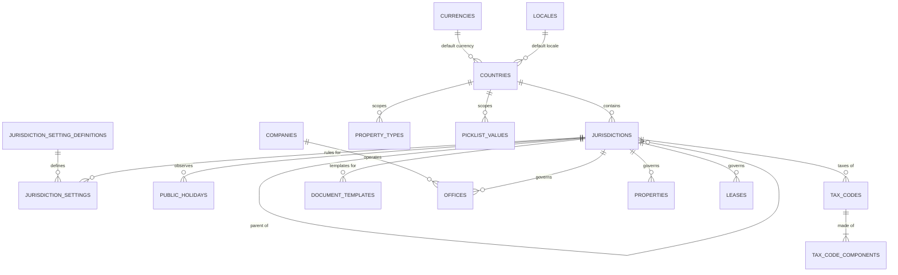
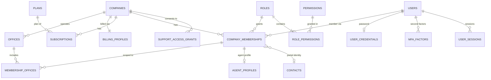
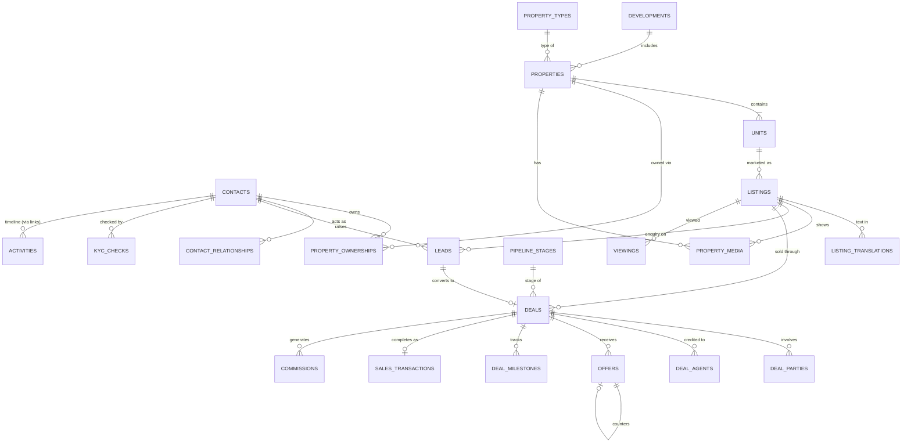
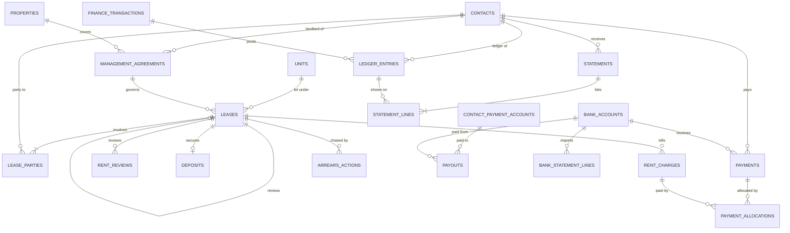
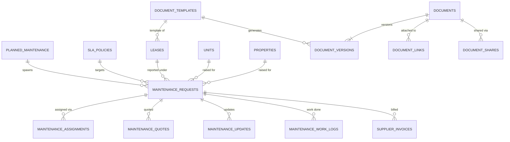

# EstatePro — Phase 2: Database Engineering

| | |
|---|---|
| Phase | 2 of 16 |
| Status | Complete. Schema executed and tested on PostgreSQL 16. |
| Builds on | [Phase 1 baseline](PHASE-1-PRODUCT-STRATEGY-ARCHITECTURE.md) and [Phase 1 detailed specification](PHASE-1-DETAILED-SPECIFICATION.md) |
| Deliverable code | [`database/migrations`](../database/migrations) (15 migrations), [`database/tests`](../database/tests), [`database/scripts/verify.sh`](../database/scripts/verify.sh) |
| Next phase | Phase 3: UI/UX System Design |

---

## Contents

1. [Summary](#1-summary)
2. [Confirmed requirements and how the schema meets them](#2-confirmed-requirements-and-how-the-schema-meets-them)
3. [Conventions](#3-conventions)
4. [Multi-tenant isolation](#4-multi-tenant-isolation)
5. [International design](#5-international-design)
6. [Schema by module](#6-schema-by-module)
7. [Entity relationship diagrams](#7-entity-relationship-diagrams)
8. [Status lifecycles](#8-status-lifecycles)
9. [Money, rent and ledger design](#9-money-rent-and-ledger-design)
10. [Indexing catalogue](#10-indexing-catalogue)
11. [Partitioning, retention and archival](#11-partitioning-retention-and-archival)
12. [Migrations and verification](#12-migrations-and-verification)
13. [Decisions and changes from Phase 1](#13-decisions-and-changes-from-phase-1)
14. [Phase 2 close-out](#14-phase-2-close-out)

---

## 1. Summary

Phase 2 delivers a production-grade PostgreSQL schema for EstatePro as executable, versioned migrations, plus automated tests that prove tenant isolation and the core business rules.

| Measure | Count |
|---|---|
| Migrations | 15 |
| Tables (excluding partitions) | 140 |
| Foreign keys | 379 (company-scoped composite keys wherever both rows belong to a company) |
| Check constraints | 379 |
| Unique constraints / unique indexes | 115 constraints, plus partial unique indexes for business rules |
| Exclusion constraints | 4 (lease overlap, agent double-booking, period overlap, commission-plan overlap) |
| Indexes | 513 on parent tables |
| Row-level security policies | 165, covering all 120 tables that carry `company_id` |
| Automated test assertions | 77, all passing |
| Seeded markets | Ghana, Qatar, United Kingdom (England, Wales, Scotland, Northern Ireland) |
| Seeded reference data | 13 currencies, 6 locales, 94 permissions, 9 system roles, 131 picklist values, 39 property types, 16 pipeline stages, 4 SLA policies, 14 milestone templates |

No country-specific workflow is hard-coded in the schema. Country behaviour is data: currencies, locales, jurisdictions, rule settings, address formats, picklists, property types, templates, tax codes and holidays.

---

## 2. Confirmed requirements and how the schema meets them

| Requirement (confirmed by product owner) | How the schema meets it |
|---|---|
| Multiple countries from launch | `countries`, `jurisdictions` (country or sub-national legal area), `offices` each with their own country, jurisdiction, currency, locale and timezone. One company can run offices in Accra, Doha and London. |
| Both sales and rentals | Separate aggregates: `listings` (type `sale` / `rent`), `deals` + `offers` + `sales_transactions` for sales; `management_agreements`, `leases`, `rent_charges`, `payments` for lettings. Pipelines exist for both `sale` and `letting` deal types. |
| Landlord and tenant portals | Portal users are `company_memberships` with `membership_type = 'portal'`, linked to their `contacts` row. System roles `landlord` and `tenant` use the `linked` scope. Documents reach portals only through explicit `document_shares`. Maintenance updates carry a `visibility` per audience. |
| Multi-tenant SaaS | `company_id` on every company-owned row, composite foreign keys, PostgreSQL row-level security on all 120 company-scoped tables, tested (Section 4). |
| Multi-country support | Jurisdiction-driven rules (`jurisdiction_settings`), country-scoped picklists and property types, international address model (Section 5). |
| Multi-currency support | Every money column has a sibling `currency_code` (ISO 4217). Payment allocation refuses currency mismatches. `fx_rates` supports reporting conversion without altering stored amounts. Currencies with 3 decimals (KWD, BHD, OMR) are supported. |
| Configurable property types by region | `property_types` is hierarchical, scoped by `country_code`, and companies can add their own types. Seeded examples: *Chamber and hall* (GH), *Compound villa* (QA), *Terraced house* (GB). |
| Country-specific lease templates | `document_templates` keyed by `template_type`, `jurisdiction_code`, `locale_code` and `version_no`, with one active version per combination; leases record the `template_id` and governing language. |
| Localisation-ready design | `locales` (with text direction), translation tables for picklists, property types and listings, `display_name_local` for native-script names, and per-user / per-contact locale preferences. |
| Timezone-aware scheduling | IANA timezone on companies, offices, properties, users and viewings. Business dates are `date`; events are `timestamptz`. `scheduled_jobs` stores the local wall-clock due time, its timezone and the UTC run time. Weekends (`countries.weekend_days`), office working days, public and company holidays feed SLA and due-date calculations. |
| Tenant-safe data isolation | Database-enforced; see Section 4 and tests in `database/tests/01_tenant_isolation.sql`. |
| Future developers, agencies, landlords and brokers | `companies.business_types`, `developments` and `development_phases`, unit-level ownership, `agent_profiles` with licensing, and `deal_agents` for co-broking splits. |

---

## 3. Conventions

| Concern | Convention |
|---|---|
| Naming | `snake_case`; plural tables; `<entity>_id` foreign keys; `*_code` for picklist codes; `*_at` timestamps; `*_on` / `*_date` business dates |
| Primary keys | `uuid` generated by `app.uuid_v7()` (time-ordered, not guessable). Swap to built-in `uuidv7()` on PostgreSQL 18. |
| Human references | `reference` text per company (e.g. `LSE-2026-000042`) from `app.next_reference()`, gap-free per company, key and year |
| Company scope | `company_id uuid NOT NULL` + `UNIQUE (company_id, id)` on every company-owned table |
| Child references | `FOREIGN KEY (company_id, parent_id) REFERENCES parent (company_id, id)` |
| Shared configuration | `company_id` nullable: `NULL` = platform default; set = company's own row |
| Money | `numeric(19,4)` + `currency_code char(3)`. Amounts are rounded to the currency's `minor_units` by the application before posting. Never floating point. |
| Rates | `numeric(7,4)` percent; tax components `numeric(9,6)`; FX `numeric(20,10)` |
| Areas | Stored in square metres, with the value and unit originally entered (sqft, acre, hectare, plot) kept for display |
| Time | `timestamptz` for events (stored UTC); `date` for business dates, interpreted in the property's or office's timezone |
| Phone and email | E.164 phone (`^\+[1-9][0-9]{6,14}$`); `citext` email |
| Lifecycle states | `text` + `CHECK` list for system lifecycles; company vocabularies via `picklist_values` codes |
| Optimistic locking | `version integer`, incremented by trigger `app.touch_row()`; the API sends it as `ETag` / `If-Match` |
| Archive | `archived_at` on business records; hard delete only for drafts and retention jobs |
| Custom fields | `custom_fields jsonb` validated against `custom_field_definitions` |
| Sensitive data | Envelope-encrypted `bytea` columns (`*_encrypted`) plus keyed hash columns for lookup (`number_hash`); `last4` for display |
| Immutability | Append-only tables reject `UPDATE`/`DELETE`; posted rows are frozen except whitelisted status columns |

---

## 4. Multi-tenant isolation

### 4.1 Database roles

| Role | Purpose | RLS |
|---|---|---|
| `estatepro_owner` (migration runner) | Owns all objects; runs migrations | Owner, not subject to RLS (policies are `ENABLE`, not `FORCE`) |
| `estatepro_app` | Runtime role for API requests and per-company worker jobs | **Subject to RLS on every company table** |
| `estatepro_auth` | Authentication service: login, sign-up, MFA, sessions | `BYPASSRLS`, but granted only identity tables plus read access to memberships and roles |
| `estatepro_platform` | Platform console, billing sync, cross-company schedulers | `BYPASSRLS`; never serves customer requests |

### 4.2 How a request is scoped

```sql
BEGIN;
SET LOCAL ROLE estatepro_app;                       -- or connect as estatepro_app
SELECT set_config('app.company_id', '<company uuid>', true);  -- transaction-local
SELECT set_config('app.user_id',    '<user uuid>',    true);
-- … queries …
COMMIT;
```

- `app.current_company_id()` returns `NULL` when unset, and every policy then evaluates false, so **missing context fails closed** (no rows, no writes).
- The setting is transaction-local, so it cannot leak through a pooled connection to the next request.

### 4.3 Defence in depth

| Layer | Mechanism | Verified by test |
|---|---|---|
| RLS `USING` | Rows of other companies are invisible to `SELECT`, `UPDATE`, `DELETE` | "A update of B contact affects 0 rows" |
| RLS `WITH CHECK` | Rows cannot be inserted or moved into another company | "A cannot insert a contact into B", "A cannot move its contact into B" |
| Composite foreign keys | A child row cannot reference another company's parent, even with a guessed id | "A unit cannot reference B property (composite FK)" |
| Shared-reference trigger | Plain FK checks ignore RLS, so references into shared configuration are checked by `app.enforce_shared_reference` | "A cannot use B private property type" |
| Partition grants | Partitions have no grants; access only through the RLS-protected parent | "app role cannot bypass RLS via a partition" |
| Secret tables | `user_credentials`, `mfa_factors`, `auth_tokens`, `external_identities`, `platform_staff` are not granted to the runtime role | "app role cannot read password hashes" |
| Global data | Reference tables are read-only for the runtime role | "app role cannot change global reference data" |
| Views | `security_invoker = true`, so views obey the caller's RLS | "B sees no A balances" |

### 4.4 Record-level scope (inside one company)

RLS isolates companies. Finer scopes from the permission matrix (`office`, `team`, `own`, `linked`, `assigned`) are enforced by the application's query scoping, using:

- `role_permissions.scope` per permission;
- `membership_offices` and `team_members` for office/team scope;
- `owner_membership_id` / `assigned_to` / `agent_membership_id` for own scope;
- `company_memberships.contact_id` joined to `property_ownerships`, `lease_parties` and `deal_parties` for portal (`linked`) scope;
- `maintenance_assignments` for `assigned` scope.

These are application rules rather than RLS because they depend on role configuration and would make every query plan expensive. Phase 15 adds automated IDOR tests for them.

---

## 5. International design

### 5.1 Reference model



### 5.2 How each market concern is handled without schema change

| Concern | Ghana example | Qatar example | UK example | Where it lives |
|---|---|---|---|---|
| Currency | GHS | QAR | GBP | `currencies`, `offices.currency_code`, each money row |
| Language & direction | en-GH | ar-QA (RTL) and en-QA | en-GB | `locales.text_direction`, translations tables |
| Timezone | Africa/Accra | Asia/Qatar | Europe/London (DST) | `countries`, `offices`, `properties.timezone` |
| Weekend | Sat–Sun | Fri–Sat | Sat–Sun | `countries.weekend_days`, `offices.working_days` |
| Address | GhanaPost GPS digital address | Zone / Street / Building numbers, no postcode | Postcode required | `countries.address_format` + `addresses.local_components` |
| Legal area | GH | QA | GB-ENG, GB-WLS, GB-SCT, GB-NIR differ | `jurisdictions` |
| Rent in advance | Often 12–24 months | Post-dated cheques common | Monthly in arrears/advance | `listings.advance_rent_periods`, `leases.advance_periods`, `payments.instrument_*`, `payment_method` picklist |
| Deposit rules | Configurable | Configurable | Scheme protection | `deposits.holder_type`, `scheme_*`, `protection_deadline` from `jurisdiction_settings` |
| Tenure | Customary / stool land | Usufruct | Commonhold, share of freehold | `tenure` picklist with `country_code` |
| ID documents | Ghana Card | QID | Passport / driving licence | `id_document_type` picklist + `identity_documents` |
| Property types | Chamber and hall, compound house | Compound villa, staff accommodation | Terraced, semi-detached, HMO | `property_types.country_code` |
| Tax | Multi-levy regimes | Configurable | VAT | `tax_codes` + effective-dated `tax_code_components` |
| Payouts | Mobile money | Bank | Bank | `contact_payment_accounts.account_type` |
| Lease document | Local template | Arabic/English template | Per-nation templates | `document_templates` by jurisdiction + locale |

### 5.3 Rule settings instead of country code branches

The application never checks `if country = 'GB'`. It reads a typed rule by key, resolved in this order:

1. `company_settings` for the office
2. `company_settings` for the company
3. `jurisdiction_settings` for the property's jurisdiction (effective-dated), then its parent jurisdiction
4. `jurisdiction_setting_definitions.default_value`

Sixteen rule keys are defined (e.g. `deposit_protection_deadline_days`, `advance_rent_max_months`, `notice_min_days_landlord`, `lease_registration_required`, `tenant_eligibility_check_required`). **No legal values are seeded.** Each must be entered with a `source_reference` after legal review in that market. This avoids shipping wrong legal rules and keeps rule changes out of code releases.

### 5.4 Names and people

- `display_name` is always present; `given_name` / `family_name` are optional, because many naming conventions do not fit first/last.
- `display_name_local` holds a native-script name (e.g. Arabic) for documents and search.
- Organisations are contacts of `contact_type = 'organisation'`, with registration and tax numbers.

### 5.5 Scheduling across timezones

- Due dates (rent due, lease end, review dates) are `date` values in the property's timezone.
- `scheduled_jobs` holds `local_due` (wall-clock), `timezone` and `run_at` (UTC). The scheduler recomputes `run_at` when tz rules change, so a reminder set for 08:00 in London stays at 08:00 across daylight-saving changes.
- `app.lease_arrears(p_as_of date)` takes the business date as a parameter instead of using the server's date.
- SLA clocks use `sla_policies.business_hours_only` with office working days and holidays; emergencies run on the clock.

---

## 6. Schema by module

Full definitions are in the migration files. Each table below lists its purpose, key relationships and the most important constraints. Unless stated, every table has `company_id`, a UUIDv7 `id`, `UNIQUE (company_id, id)`, timestamps and an RLS policy.

### 6.1 Companies, subscriptions and billing — `0003_companies_identity.sql`

| Table | Purpose | Key constraints |
|---|---|---|
| `companies` | SaaS customer (the isolation boundary) | `status` ∈ trial, active, past_due, read_only, suspended, cancelled; `business_types` ⊆ agency, property_manager, developer, landlord, broker; HQ country, base currency, locale, timezone, fiscal year start, `data_region` (deployment cell) |
| `billing_profiles` | Billing contact, address, tax ID, provider customer ID | One per company; no card data |
| `subscriptions` | Plan, interval, seats, provider subscription, period | Partial unique index: one live subscription per company |
| `subscription_invoices` | Mirror of provider invoices | `provider_invoice_id` unique |
| `usage_counters` | Metered usage per metric and period | PK (company, metric, period_start) |
| `plans`, `plan_prices`, `plan_entitlements` | Global plan catalogue, price per currency/interval, feature flags and limits | Limits filled in Phase 14 |

### 6.2 Users, authentication and permissions — `0003`

| Table | Purpose | Key constraints |
|---|---|---|
| `users` | Global identity (one login across companies) | Unique `citext` email; status pending/active/locked/disabled |
| `user_credentials` | Argon2id password hash, lockout counters | Auth role only |
| `mfa_factors` | TOTP, WebAuthn, recovery codes | WebAuthn requires credential id + public key |
| `external_identities` | SSO subject per provider | Unique (provider, subject) |
| `auth_tokens` | Email verification, reset, magic link | Stored hashed; single use |
| `user_sessions` | Refresh-token sessions with rotation family | Hashed token; idle and absolute expiry; revocation reason |
| `permissions` | Catalogue of `resource.action` keys | 94 seeded; `is_sensitive` flags step-up/audit |
| `roles` | System roles (`company_id NULL`) and custom roles | `is_system` ⇔ `company_id IS NULL`; audience staff/portal |
| `role_permissions` | Permission + scope per role | Scope ∈ all, office, team, own, linked, assigned; company inherited from role by trigger |
| `company_memberships` | User ↔ company with role, type (staff/portal), status | One per (company, user); portal members must link to a contact |
| `membership_offices`, `teams`, `team_members` | Office and team scope | Composite FKs |
| `agent_profiles` | Agent licence number, authority, country, expiry, languages, specialisms | Licence expiry index for reminders |
| `invitations` | Pending invites with hashed token | One open invite per email per company |
| `api_keys` | Scoped integration keys | Hashed; prefix shown in UI |
| `platform_staff` | EstatePro employees | Not visible to companies |
| `support_access_grants` | Consented, time-boxed support access | Approved grants need approver, start and expiry |
| `offices` | Branches with own country, jurisdiction, currency, locale, timezone, working days, licence | One head office; unique code per company |
| `addresses` | International address model | Lat/long paired; trigram index on formatted address |

### 6.3 Configuration — `0004_configuration.sql`

| Table | Purpose |
|---|---|
| `company_settings` | Office- or company-level overrides of rule keys and preferences |
| `picklist_values` (+ `_translations`) | Controlled vocabularies, platform or company, optionally per country |
| `property_types` (+ `_translations`) | Hierarchical, country-scoped, company-extendable property and unit types |
| `tax_codes`, `tax_code_components` | Jurisdiction tax codes with effective-dated, optionally compound components |
| `custom_field_definitions` | Company-defined fields per entity type |
| `number_sequences` + `app.next_reference()` | Per-company, per-year human references |
| `company_holidays` | Office or company closures |

### 6.4 Clients (contacts) and CRM — `0005_contacts_crm.sql`

| Table | Purpose | Key constraints and indexes |
|---|---|---|
| `contacts` | Every buyer, seller, landlord, tenant, supplier, as person or organisation | Generated `search_vector` (GIN); trigram on name; email and phone lookup indexes for dedupe; `merged_into_contact_id` for merges |
| `contact_relationships` | Buyer / seller / landlord / tenant / applicant / guarantor / supplier / developer / investor roles | One active row per contact and type |
| `contact_methods` | Additional emails, phones, WhatsApp | `normalised` value indexed for dedupe |
| `contact_links` | Director-of, spouse, representative, power of attorney | No self-links |
| `contact_payment_accounts` | Bank or mobile-money accounts for payouts and refunds | Encrypted number; `changed_at` drives payout cooling-off |
| `identity_documents` | KYC identity documents | Encrypted number + keyed hash for duplicate detection |
| `kyc_checks` | Identity, address, source-of-funds, sanctions/PEP, ownership checks | Verified/failed require reviewer and time |
| `consents` | Purpose, channel, lawful basis, evidence | History kept (latest wins) |
| `requirements` | What a buyer or tenant wants | Price range sanity; rent frequency only for rent |
| `activities` + `activity_links` | Timeline of calls, emails, messages, notes, system events | Links to many records; synced mail deduplicated by `external_message_id` |
| `tasks` | Follow-ups with owner and due time | Index for "my open tasks"; done requires `completed_at` |
| `leads` | Enquiry with source, type, owner, score and breakdown | Lost requires reason; first response cannot precede receipt; queue and unassigned indexes |
| `lead_status_history`, `lead_assignments` | Transitions and reassignment history | For response-time and conversion reports |

### 6.5 Properties, units, listings and media — `0006_properties_listings.sql`

| Table | Purpose | Key constraints and indexes |
|---|---|---|
| `developments`, `development_phases` | Developer projects and phases | Status lifecycle |
| `properties` | Physical asset: type, address, jurisdiction, timezone, tenure, title ref, land area | Unique reference per company |
| `units` | Lettable/sellable part with rooms, area, furnishing, availability | One whole-property unit per property; unique label per property; `availability` includes `under_maintenance` |
| `unit_features` | Feature codes per unit | Indexed by feature for search |
| `property_ownerships` | Owners with share, type and dates; unit-level for strata ownership | Share 0–100; date order |
| `listings` | Marketing campaign for a unit (sale or rent) | Rent requires frequency; sale cannot be `rented`, rent cannot be `sold`; published only in live statuses; **one open listing per unit and type** |
| `listing_translations` | Title/description per language; AI drafts need a named approver | PK (listing, locale) |
| `listing_status_history`, `listing_price_history` | Days-on-market and price-change reporting | — |
| `listing_publications` | Portal/website syndication status | Unique per channel |
| `property_media` | Photos, videos, floor plans, virtual tours, site plans | Exactly one of storage key or external URL; one cover per listing |
| `property_notes` | Notes with audience (internal/landlord/tenant) | — |
| `key_sets`, `key_movements` | Key register | Check-out requires a holder |

### 6.6 Agents

Agents are staff `company_memberships` with an `agent_profiles` row (licence, languages, specialisms). Commission settings are `commission_plans` assigned through `membership_commission_plans`, where an exclusion constraint prevents overlapping plan periods for one agent (Section 6.10). Agents on a deal and their splits are `deal_agents`.

### 6.7 Leads, viewings and sales — `0007_sales_pipeline.sql`

| Table | Purpose | Key constraints and indexes |
|---|---|---|
| `pipeline_stages` | Configurable stages mapped to fixed `stage_class` | Won = 100%, lost = 0% probability |
| `milestone_templates` | Post-acceptance steps by jurisdiction and deal type | Copied to each deal |
| `deals` | Sale or letting opportunity | `stage_class` synced from stage by trigger (and must match deal type); generated `status` open/won/lost; closed requires `closed_at`; lost requires reason; late stages require a listing or unit |
| `deal_stage_history` | Stage transitions | Time-in-stage, stalled deals |
| `deal_parties` | Buyer, seller, lawyers, lender, other agent | — |
| `deal_agents` | Agents credited and split percentages | — |
| `viewings` + `viewing_attendees` | Appointments with outcome and feedback | **Exclusion constraint: an agent cannot have overlapping live viewings**; completed requires outcome |
| `offers` | Offer and counter-offer chain | Terms immutable (trigger); one accepted offer per listing |
| `deal_milestones` | Progression checklist | Completed requires who and when |
| `sales_transactions` | Agreed price, agency fee, contract and completion | One per deal; completed requires date; fallen-through requires reason |

### 6.8 Leases, rent and payments — `0008_leases_rent.sql`

| Table | Purpose | Key constraints and indexes |
|---|---|---|
| `bank_accounts` | Client-money, deposit-holding and operating accounts (bank, mobile money, cash, provider) | Currency per account |
| `financial_periods` | Open/locked periods | No overlapping periods (exclusion) |
| `management_agreements` | Landlord instruction: service level, fee basis, approval limit, float, payout schedule | Fee fields required for the chosen basis |
| `leases` | Rental agreement: dates, rent, frequency, due day, advance periods, deposit, notice, break clause, template, language | Fixed-term needs end date; live statuses need signature; **exclusion: no overlapping live leases on a unit**; renewal chain via `previous_lease_id` |
| `lease_parties` | Tenants, co-tenants, occupants, guarantors, landlords | One primary tenant |
| `rent_reviews` | Scheduled and agreed rent changes | Agreed requires amount and effective date |
| `rent_charges` | What is owed per period (rent, service charge, fees, recharges) | **Unique per lease, type and period** (idempotent rent runs); generated `total_amount` |
| `payments` | Money received (any method, including post-dated cheques and mobile money) | Unique provider reference and idempotency key; bounced/voided/refunded need reason |
| `payment_allocations` | Which payment paid which charge | Append-only; trigger validates cleared payment, posted charge, same currency, no over-allocation; reversals must exactly negate |
| `deposits`, `deposit_deductions` | Deposit holding, protection and return | Returned ≤ amount; protected requires scheme reference |
| `arrears_actions`, `payment_plans` | Arrears workflow and agreements | Next-action index |
| `inspections`, `inspection_items` | Move-in/out, periodic, pre-listing, safety | Completed requires time |
| View `rent_charge_balances`, function `app.lease_arrears(date)` | Outstanding balances and ageing buckets | Obey caller RLS |

### 6.9 Maintenance — `0009_maintenance.sql`

| Table | Purpose | Key constraints and indexes |
|---|---|---|
| `sla_policies` | Priority codes with response/resolution targets | Platform defaults: emergency, urgent, routine, planned |
| `maintenance_requests` | Work order with source, category, priority, SLA due times, costs, approval | Reporter required (unless planned); on-hold needs reason; closed needs cost responsibility; **cannot be in progress while approval is pending** |
| `maintenance_assignments` | In-house staff or supplier | One active assignment per request |
| `maintenance_status_history` | Transitions for SLA reporting | — |
| `maintenance_updates` | Progress notes with audience | — |
| `maintenance_quotes` | Supplier quotes | One accepted quote per request |
| `maintenance_work_logs` | Labour, materials and cost | — |
| `planned_maintenance` | Recurring jobs (RFC 5545 RRULE) | Due index |

Images on maintenance requests are `documents` linked through `document_links` (entity type `maintenance_request`), so they share scanning, versioning and portal sharing rules.

### 6.10 Finance — `0010_finance.sql`

| Table | Purpose | Key constraints |
|---|---|---|
| `supplier_invoices` | Bills from contractors, chargeable to landlord/agency/tenant/development | Unique invoice number per supplier; approved states need approver |
| `commission_plans` | Tiered or flat commission rules | Tiers must be a non-empty JSON array |
| `membership_commission_plans` | Plan per agent over time | No overlapping periods (exclusion) |
| `commissions` | Commission per agent per deal with calculation snapshot | **Agent cannot approve own commission**; negative only as an adjustment; one live commission per agent per deal |
| `finance_transactions` | Operational income and expenditure events | Posted/reversed rows frozen (trigger); locked periods enforced (trigger) |
| `ledger_entries` | Party ledgers: landlord, tenant, supplier, agency, deposit | Append-only; exactly one of debit/credit; locked periods enforced |
| View `ledger_balances` | Balance per party and currency | Obeys RLS |
| `statements`, `statement_lines` | Landlord statements | Closing = opening + income − fees − expenses − payouts (check); frozen once issued |
| `payouts` | Payments to landlords, suppliers, refunds | **Requester cannot approve**; approved/paid states need approver/date |
| `bank_statement_lines` | Imported bank lines and matching | Fingerprint prevents re-import; matched requires a target |

### 6.11 Documents — `0011_documents.sql`

| Table | Purpose | Key constraints |
|---|---|---|
| `document_templates` | Lease, sale, notice, statement, receipt, message templates by jurisdiction and language | One active version per company/code/jurisdiction/locale |
| `documents` | Logical document: type, category, confidentiality, expiry, retention, legal hold | Expiry index for compliance reminders |
| `document_versions` | Immutable file versions with checksum and malware-scan state | Unique version number; storage key cannot change after upload |
| `document_links` | Attach a document to any record | 16 allowed entity types |
| `document_shares` | Explicit portal or staff sharing, with expiry and revocation | Exactly one recipient |
| `required_document_rules` | Required documents by jurisdiction and condition, optionally blocking a status | — |

### 6.12 Audit logs, notifications and automation — `0012_notifications_automation_audit.sql`

| Table | Purpose | Key constraints |
|---|---|---|
| `audit_logs` | Who did what, to which record, with changed fields, IP, request ID, support-grant context | **Partitioned monthly**; append-only (trigger + grants) |
| `notifications` | In-app alerts per member | **Partitioned monthly**; unread inbox index |
| `notification_preferences` | Per type and channel, with quiet hours | — |
| `message_deliveries` | Email/SMS/WhatsApp/push delivery log | Idempotency key; provider message id unique |
| `automation_rules`, `automation_runs` | Event, date-offset and scheduled rules with conditions and actions | Actions must be a non-empty array |
| `scheduled_jobs` | Timezone-aware due jobs | Unique idempotency key per company |
| `outbox_events` | Transactional outbox for domain events | Unpublished index |
| `webhook_endpoints`, `webhook_deliveries` | Outbound webhooks | HTTPS only; one delivery per endpoint and event |
| `import_jobs`, `export_jobs` | Async imports (with dry run) and exports | — |
| `idempotency_keys` | API replay protection | 24-hour expiry |
| `ai_requests` | EstateAI usage and outcome (accepted/edited/discarded) | — |

---

## 7. Entity relationship diagrams

### 7.1 Tenancy, identity and access



### 7.2 Properties, CRM and sales



### 7.3 Lettings, rent and finance



### 7.4 Maintenance and documents



---

## 8. Status lifecycles

Allowed values are enforced by `CHECK` constraints. Allowed **transitions** are enforced by the application's state machines (Phase 4+), recorded in the matching `*_status_history` table, and backed by the constraints listed here.

| Entity | Statuses | Database-enforced rules |
|---|---|---|
| Listing | draft → available ⇄ reserved → under_contract → sold / rented; withdrawn, expired | Sold only for sale, rented only for rent; publish only when live; one open listing per unit and type |
| Unit availability | available, under_maintenance, owner_occupied, unavailable | Independent of listing status |
| Lead | new → contacted → qualified → converted; unqualified, lost | Lost requires reason |
| Deal | Stage classes lead → qualification → viewing → negotiation → offer_accepted → contract → closed_won; closed_lost from any stage | Stage must match deal type; closed requires `closed_at`; lost requires reason |
| Offer | submitted → countered / accepted / rejected / withdrawn / expired | Terms immutable; one accepted per listing |
| Viewing | scheduled → confirmed → completed; cancelled, no_show, rescheduled | Completed requires outcome; no agent double-booking |
| Sale | pending → exchanged → completed; fallen_through, rescinded | Completed requires date; fallen-through requires reason |
| Lease | draft → pending_signature → active → (periodic) → notice_given → ended → closed; cancelled | Live states require signature; no overlapping live leases; notice requires date and party |
| Rent charge | scheduled → posted; waived, cancelled | Unique per period; waived requires reason |
| Payment | pending → cleared; bounced, refunded, voided | Only cleared payments can be allocated |
| Deposit | expected → held → protected → return_pending → returned / partially_returned; forfeited, disputed | Protected requires scheme reference |
| Work order | reported → assigned → (awaiting_approval) → in_progress ⇄ on_hold → completed → closed; cancelled | No work while approval pending; closed requires cost responsibility |
| Finance transaction | draft → posted → reversed | Posted rows frozen; locked periods rejected |
| Statement | draft → issued; void | Frozen when issued; arithmetic check |
| Payout | pending_approval → approved → sent → paid; failed, cancelled | Requester ≠ approver |
| Commission | pending → approved → payable → paid; held, cancelled | Agent ≠ approver |
| Document version | pending → clean / infected / failed | File fields immutable |

---

## 9. Money, rent and ledger design

### 9.1 Principles

1. **Charges, payments and allocations are separate rows.** Balances are derived, never stored, so they can always be recomputed and audited.
2. **Nothing posted is edited.** Allocations, ledger entries and audit events are append-only; finance transactions and statements freeze when posted or issued. Corrections are reversals.
3. **Periods lock.** Once an accountant locks a period, inserts and edits dated inside it are rejected by the database.
4. **No silent FX.** A payment can only be allocated to a charge in the same currency. Conversion exists only in reporting (`fx_rates`).
5. **Separation of duties** is enforced in constraints for payouts and commissions.

### 9.2 Worked example (this is the automated test scenario)

Lease LSE-2026-000001, Accra, rent GHS 6,000 monthly, due on the 1st.

| Step | Rows written | Result |
|---|---|---|
| Rent run creates January and February charges | `rent_charges` ×2 (6,000 each) | Re-running the job cannot duplicate them (unique period index) |
| Tenant hands over a post-dated cheque for 9,000 dated 1 Jan | `payments` status `pending`, `instrument_date` 2026-01-01 | Allocation attempt is rejected until the cheque clears |
| Cheque clears | `payments.status = cleared` | — |
| Allocate 6,000 to January, 2,000 to February | `payment_allocations` ×2 | January outstanding 0; February outstanding 4,000; a further 3,500 is rejected (only 1,000 unallocated) |
| Mistaken allocation reversed | `payment_allocations` row of −6,000 pointing to the original | January outstanding back to 6,000 |
| Arrears as of 15 March | `app.lease_arrears('2026-03-15')` | 61–90 days: 6,000; 31–60 days: 4,000; total 10,000 |
| Rent credited to landlord, fee debited | `ledger_entries` credit 6,000, debit 600 | Landlord balance 5,400 |
| January locked | `financial_periods` locked | New entries dated in January rejected; February accepted |
| Payout requested and approved by the same person | `payouts` | Rejected by check constraint |

---

## 10. Indexing catalogue

### 10.1 Rules

- Every company-scoped index **leads with `company_id`**, matching the RLS predicate.
- Every company-scoped foreign key between business tables has an index whose leading columns match it (migration `0015`). References to fixed reference data (currencies, countries, roles, property types, stages, tax codes, templates), to documents, and staff "who did it" columns (`created_by`, `approved_by`) are deliberately not indexed: their parent rows are never deleted and they are not lookup paths.
- Work queues use **partial indexes** on the open states only, so they stay small as history grows.
- Text search uses `tsvector` (GIN) and trigram (GIN) indexes; exact lookups use B-tree.
- Uniqueness that only applies to "live" rows uses partial unique indexes.

### 10.2 Key indexes and the queries they serve

| Index | Serves |
|---|---|
| `leads_queue_idx (company_id, assigned_to, status, next_action_at) WHERE open` | Agent's lead queue sorted by next action |
| `leads_unassigned_idx (company_id, office_id, received_at) WHERE unassigned new` | Lead distribution |
| `tasks_my_open_idx (company_id, assigned_to, due_at) WHERE open` | "My tasks" on every dashboard |
| `listings_search_idx (company_id, listing_type, status, price)` | Listing search and filters |
| `units_search_idx (company_id, bedrooms, floor_area_sqm)` | Requirement matching |
| `contacts_search_idx` (GIN tsvector), `contacts_name_trgm_idx` | Global search, fuzzy name lookup |
| `contacts_email_idx`, `contacts_phone_idx`, `contact_methods_dedupe_idx` | Duplicate detection on create and import |
| `deals_pipeline_idx (company_id, deal_type, stage_class, owner)` | Pipeline board |
| `deals_forecast_idx (company_id, expected_close_date) WHERE open` | Forecast by month |
| `viewings_calendar_idx (company_id, agent, scheduled_start)` | Agent diary |
| `viewings_feedback_due_idx WHERE scheduled/confirmed` | Feedback chasing |
| `leases_expiry_idx (company_id, end_date) WHERE active/notice_given` | Renewal dashboard, 30/60/90-day reminders |
| `rent_charges_due_idx (company_id, due_date) WHERE posted` | Rent due and arrears runs |
| `payment_allocations_charge_idx`, `_payment_idx` | Balance computation |
| `payments_pending_instruments_idx (company_id, instrument_date) WHERE pending` | Post-dated cheques due for banking |
| `maintenance_open_queue_idx (company_id, status, resolution_due_at) WHERE open` | Maintenance board, SLA breach detection |
| `maintenance_approval_idx WHERE pending` | Landlord approvals queue |
| `ledger_entries_party_idx (company_id, ledger_type, contact_id, currency, entry_date)` | Landlord balances and statements |
| `finance_transactions_date_idx (company_id, txn_date, txn_type) WHERE not draft` | Income/expense reports |
| `documents_expiry_idx WHERE expires_on set` | Compliance expiry reminders |
| `audit_logs_entity_idx (company_id, entity_type, entity_id, occurred_at)` | Record history panel |
| `scheduled_jobs_due_idx (run_at) WHERE pending` | Scheduler polling |
| `outbox_events_unpublished_idx WHERE unpublished` | Event relay |

Index choices must be revalidated against real query plans (`EXPLAIN (ANALYZE, BUFFERS)`) with production-like volumes during Phase 16 performance testing.

---

## 11. Partitioning, retention and archival

| Table | Strategy |
|---|---|
| `audit_logs` | Monthly range partitions on `occurred_at`, a default partition, and `app.ensure_monthly_partitions()` run monthly to create upcoming months. Older partitions are detached and exported to write-once storage after the retention period. |
| `notifications` | Monthly partitions; read notifications older than 12 months dropped by partition. |
| `message_deliveries`, `outbox_events`, `webhook_deliveries`, `idempotency_keys` | Purged by age (outbox after publish + 7 days; idempotency keys at expiry). Partition when volume requires it. |
| Business records | Archived (`archived_at`), never hard-deleted while in retention. Personal data is anonymised (`contacts.is_anonymised`) on erasure requests where no legal hold or retention duty applies. |
| Documents | `retention_until` and `legal_hold` per document; a retention job deletes object-storage files and marks versions only when both allow it. |

Default retention periods (Phase 1 §14.5) are configurable per jurisdiction and confirmed during Phase 15.

---

## 12. Migrations and verification

### 12.1 Files

| Migration | Contents |
|---|---|
| `0001_roles_extensions_helpers.sql` | Roles, extensions, UUIDv7, request context, generic triggers |
| `0002_global_reference.sql` | Currencies, locales, countries, jurisdictions, rule settings, holidays, FX, plans |
| `0003_companies_identity.sql` | Companies, billing, subscriptions, addresses, offices, users, auth, roles, memberships, teams, agents, sessions, API keys, support access |
| `0004_configuration.sql` | Settings, picklists, property types, tax codes, custom fields, references, holidays |
| `0005_contacts_crm.sql` | Contacts, relationships, payment accounts, KYC, consents, requirements, activities, tasks, leads |
| `0006_properties_listings.sql` | Developments, properties, units, ownership, listings, media, notes, keys |
| `0007_sales_pipeline.sql` | Stages, milestones, deals, viewings, offers, sales transactions |
| `0008_leases_rent.sql` | Bank accounts, periods, management agreements, leases, charges, payments, allocations, deposits, arrears, inspections, balance views |
| `0009_maintenance.sql` | SLA policies, work orders, assignments, quotes, work logs, planned maintenance |
| `0010_finance.sql` | Supplier invoices, commissions, finance transactions, ledgers, statements, payouts, bank statement lines |
| `0011_documents.sql` | Templates, documents, versions, links, shares, required-document rules |
| `0012_notifications_automation_audit.sql` | Notifications, deliveries, automation, scheduled jobs, audit, outbox, webhooks, imports/exports, idempotency, AI usage |
| `0013_security_rls_triggers.sql` | Auth role, inheritance and shared-reference triggers, version triggers, grants, RLS policies |
| `0014_seed_reference_data.sql` | Markets, rule keys, plans, permissions, system roles, picklists, property types, stages, SLAs, milestones, company provisioning |
| `0015_foreign_key_indexes.sql` | 107 indexes for company-scoped foreign keys between business tables |

### 12.2 Running the checks

```bash
# Needs PostgreSQL 16+ and a superuser connection (PGHOST/PGUSER/etc.)
database/scripts/verify.sh            # creates estatepro_verify, applies all migrations, runs all tests
```

The script stops with a non-zero exit code on the first failed migration or assertion.

### 12.3 Results of this phase's run (PostgreSQL 16.15)

- All 15 migrations applied to an empty database without errors.
- `01_tenant_isolation.sql`: 34 assertions passed (context fail-closed, RLS read/write isolation, composite FKs, shared configuration, secrets, partitions, users, views, audit log, company switching).
- `02_business_rules.sql`: 43 assertions passed (references, version locking, listing rules, lease overlap and signature, idempotent rent run, cheque clearing, allocation limits, reversal, arrears ageing, posting freeze, ledger append-only, period lock, separation of duties, pipeline stage rules, offer immutability, viewing double-booking, maintenance approval, document version immutability).

### 12.4 Migration practice (applies from Phase 4 onwards)

- Forward-only, numbered migrations; never edit a migration that has run in a shared environment.
- **Expand / contract** for zero-downtime changes: add new columns or tables → deploy code writing both → backfill in batches → switch reads → drop the old structure in a later release.
- Long backfills run as batched background jobs, not inside a migration transaction.
- `CREATE INDEX CONCURRENTLY` for indexes on large existing tables (in its own migration, outside a transaction).
- The verify script runs in CI on every change.

---

## 13. Decisions and changes from Phase 1

| Topic | Phase 1 position | Phase 2 decision | Reason |
|---|---|---|---|
| Money type | Baseline: fixed-precision decimal. Detailed spec: integer minor units. | `numeric(19,4)` + currency, rounded to the currency's minor units at posting | Matches the baseline; handles 0-, 2- and 3-decimal currencies and pro-rated intermediates without per-currency scaling bugs |
| Branch naming | "Branches" (detailed spec) / "Offices" (baseline) | `offices` | Matches the baseline and common usage across the three markets |
| Table naming | Mixed | Baseline names kept: `company_memberships`, `contact_relationships`, `rent_charges`, `payments`, `payment_allocations`, `maintenance_requests`, `property_media`, `audit_logs` | Consistency with the approved baseline |
| "Under Maintenance" status | A listing status in the brief | Unit `availability = 'under_maintenance'`, shown alongside the listing status in the UI | Keeps the marketing lifecycle intact while blocking viewings and new lets |
| PostGIS | Recommended | Latitude/longitude columns now; PostGIS geography column and GiST index added when map search is built (Phase 4) | Works on any PostgreSQL; PostGIS is available on all major managed services |
| Legal rule values | Configurable | Rule *keys* seeded, *values* not seeded | Values must come from legal review in each market |
| Tax rates | Configurable | Structure only; no rates seeded | Rates change and differ by levy; must be verified per market |
| RLS mode | Defence in depth | `ENABLE` (not `FORCE`) with a non-owner runtime role | Lets integrity functions see all rows while the runtime role is always restricted |

---

## 14. Phase 2 close-out

### 14.1 Completed deliverables

| # | Deliverable | Location |
|---|---|---|
| 1 | Complete schema for companies, subscriptions and billing data | `0003` |
| 2 | Users, authentication, sessions, MFA, roles, permissions | `0003`, `0013`, `0014` |
| 3 | Properties, units, categories (property types), ownership | `0004`, `0006` |
| 4 | Property media: photos, videos, floor plans, virtual tours | `0006` |
| 5 | Clients: buyers, sellers, landlords, tenants (single contact model) | `0005` |
| 6 | Agents: profiles, licensing, commission settings | `0003`, `0010` |
| 7 | Leads: source and status tracking, assignment, scoring | `0005` |
| 8 | Property viewings: appointments and outcomes | `0007` |
| 9 | Sales: deals, offers, milestones, transactions, contracts | `0007` |
| 10 | Leases: agreements, parties, reviews, renewal chain | `0008` |
| 11 | Rent payments: charges, payments, allocations, arrears, deposits | `0008` |
| 12 | Maintenance requests: tickets, assignments, quotes, status updates | `0009` |
| 13 | Finance: income, expenses, commissions, ledgers, statements, payouts | `0010` |
| 14 | Documents: contracts, ownership documents, versions, sharing, templates | `0011` |
| 15 | Audit logs (partitioned, append-only) | `0012` |
| 16 | Notifications, reminders, automation, scheduling | `0012` |
| 17 | International reference model and Ghana / Qatar / UK seed data | `0002`, `0014` |
| 18 | Primary keys, foreign keys, constraints, relationships, indexes | All migrations; Sections 6 and 10 |
| 19 | Row-level security across all company tables | `0013` |
| 20 | Executable verification with 77 passing assertions | `database/tests`, `database/scripts/verify.sh` |

### 14.2 Database requirements (carried forward)

- PostgreSQL 16+ (managed), extensions `pgcrypto`, `citext`, `pg_trgm`, `btree_gist`; PostGIS when map search lands.
- Four database roles as in §4.1; the runtime role must never own objects.
- Connection pooling in transaction mode (PgBouncer or equivalent) — compatible because context is `SET LOCAL`.
- Monthly job: `app.ensure_monthly_partitions()` for `audit_logs` and `notifications`.
- Nightly integrity job: report orphaned polymorphic links (`activity_links`, `document_links`, `tasks`).
- Key management for envelope encryption (per-company data keys) — Phase 15.

### 14.3 API requirements (derived from the schema)

- Every request sets `app.company_id` and `app.user_id` with `SET LOCAL` inside its transaction.
- Optimistic concurrency via `version` → `ETag` / `If-Match`; `412` on mismatch.
- State changes go through action endpoints that write the status-history row and an outbox event in the same transaction.
- Money endpoints require `Idempotency-Key` (`idempotency_keys`) and return amounts as `{ "amount": "6000.00", "currency": "GHS" }` (string decimals, never JSON floats).
- References are generated server-side with `app.next_reference()`.
- Map database errors to RFC 9457 problem responses: `23505` → 409 conflict, `23P01` → 409 (overlap), `23514` / `23503` → 422 validation, `42501` → 403/404.
- Portal endpoints apply `linked` scope joins; document downloads check `document_shares` and `scan_status = 'clean'`.

### 14.4 Security requirements

- RLS on every company table (done) plus application scoping for office/team/own/linked/assigned.
- Encrypted columns for bank, mobile-money, ID numbers and date of birth; never logged; revealed only with `contact.view_sensitive` and audited.
- Payout cooling-off after `contact_payment_accounts.changed_at`; step-up MFA for permissions marked `is_sensitive`.
- Audit log writes for every sensitive permission use; audit table append-only.
- Support access only through approved `support_access_grants`; actions carry `support_grant_id`.
- CI runs `verify.sh`; Phase 15 adds penetration-style IDOR tests at the API layer.

### 14.5 UI requirements (input to Phase 3)

The schema implies these interface needs, which Phase 3 must design for:

- **Work queues** backed by the partial indexes: my tasks, my leads, unassigned leads, viewings needing feedback, offers awaiting response, leases expiring in 30/60/90 days, rent due and arrears ageing, post-dated cheques to bank, work orders by SLA, approvals (landlord quotes, payouts, commissions), expiring documents and licences.
- **Status display**: listing status plus unit availability as one badge; status history panels on every record.
- **International inputs**: address forms driven by `countries.address_format`; phone inputs with country code; currency-aware money inputs; area inputs with unit choice; bilingual listing text; right-to-left layout for Arabic.
- **Timezone clarity**: show times in the property's or user's timezone with the zone label where they differ.
- **Masked sensitive fields** with an audited reveal.
- **Portal views** (landlord, tenant) and a mobile-first technician view.
- Phase 3 requirements received from the product owner are recorded in §14.8.

### 14.6 Scalability considerations

- UUIDv7 keys keep B-tree inserts append-mostly.
- All hot paths are covered by `company_id`-led indexes; queues use partial indexes.
- Derived balances are views now; if statement or arrears queries exceed targets at scale, add incrementally maintained summary tables fed from the outbox (same results, verified against the views).
- Partitioned audit and notifications; purge jobs for logs.
- Read replicas for reports and exports (views use `security_invoker`, so the same RLS applies).
- Large companies can be moved to a dedicated cell or database without schema change (`companies.data_region`).

### 14.7 Potential risks

| Risk | Impact | Mitigation |
|---|---|---|
| Legal rule values entered incorrectly for a market | Wrong deadlines or deposit handling | Values require `source_reference` and `reviewed_at`; legal review per market before go-live |
| Polymorphic links (`activity_links`, `document_links`, task entity) have no FK | Orphans after hard deletes | Business records are archived, not deleted; nightly orphan report; application validates targets |
| Office/team/own scope is application-enforced | Over-exposure inside a company if a query forgets scope | Central scoped repository; API-level IDOR tests (Phase 15); RLS still prevents cross-company leaks |
| Derived balances become slow at very large portfolios | Slow arrears/statement screens | Summary tables via outbox when measured; indexes already in place |
| Timezone rule changes shift scheduled jobs | Reminders at the wrong local time | Store `local_due` + `timezone`; recompute `run_at` after tzdata updates |
| Seeded picklists and property types do not match local usage | Friction for agents | Companies can add, rename (via translations) and hide values; review with pilot agencies in each market |
| Schema breadth slows Phase 4+ delivery | Delay | Modules are separable; build order follows the release plan (properties → CRM → sales → lettings → maintenance → finance) |

### 14.8 Next phase roadmap — Phase 3: UI/UX System Design

**Direction from the product owner (recorded verbatim in intent):** design for operational efficiency, not visual aesthetics. Prioritise fast daily workflows, minimal clicks, role-based dashboards, data density without clutter, enterprise usability, mobile responsiveness for field agents, accessibility standards and a consistent design system. Avoid glassmorphism, excessive animation, widgets with no operational value, marketing-style interfaces and generic admin-template layouts. The interface should resemble professional business software used daily by agencies, property managers and brokers.

Phase 3 will deliver:

1. Design system
2. Information architecture
3. Navigation structure
4. Desktop wireframes
5. Tablet wireframes
6. Mobile wireframes
7. User flows
8. Role-specific dashboards
9. Component library
10. Design tokens
11. Accessibility standards
12. Responsive behaviour guidelines

…plus the standard close-out (deliverables, database, API, security, UI, scalability, risks, Phase 4 roadmap). Each dashboard will be built from the work queues in §14.5, so every widget maps to a real query and an action.
