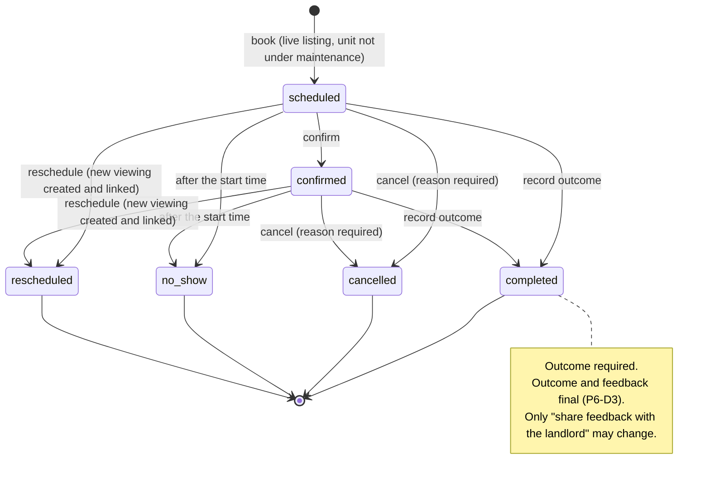
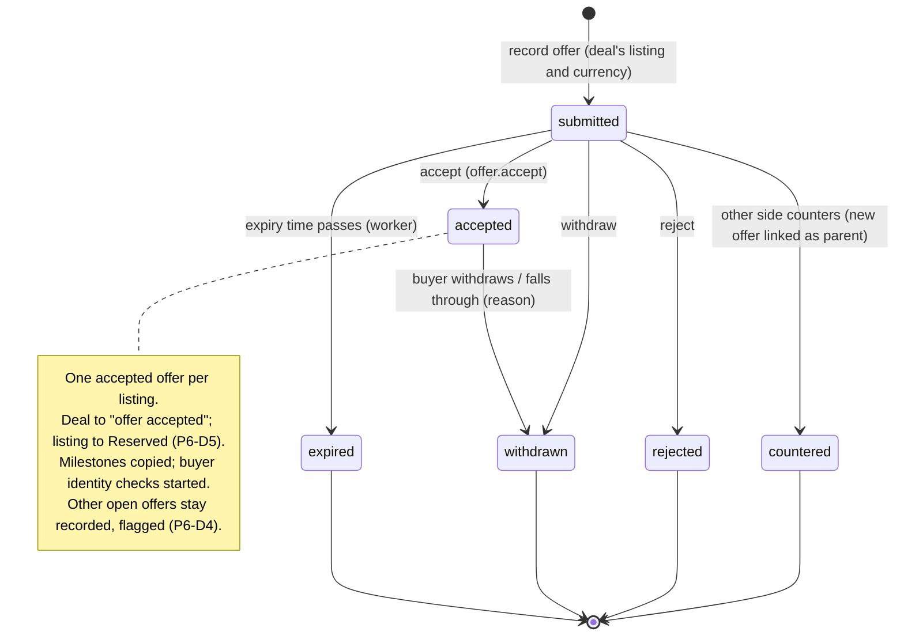
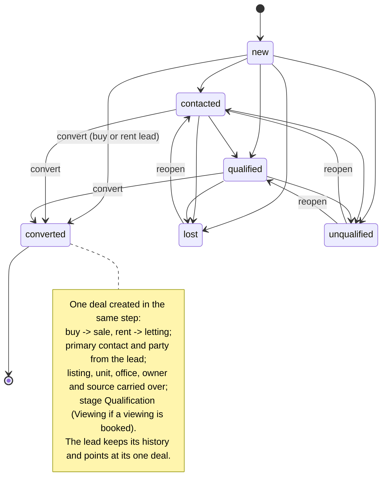
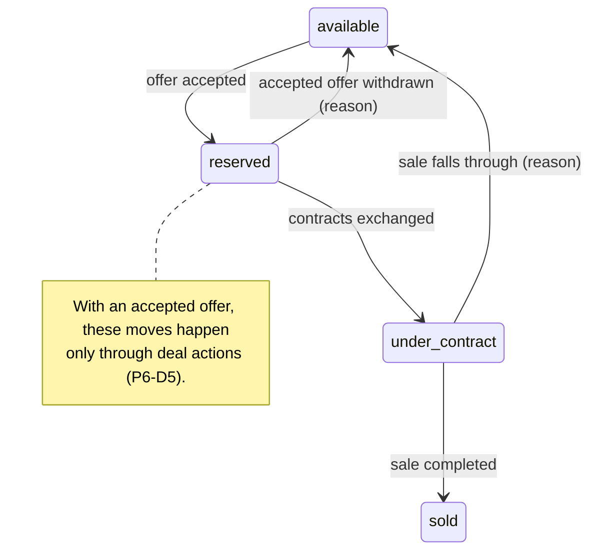

# Phase 6 Readiness Report (Sales pipeline)

| | |
|---|---|
| Date | 12 November 2026 (revision 2) |
| Branch | `phase-6/readiness`, from `main` at `5ef896c` (pull request #39) |
| Scope | Readiness for Phase 6: viewings, offers, deals, lead conversion and landlord visibility (#5), with the preparatory milestone P6-0 (#15, erasure, permissions) |
| **Recommendation** | **GO for Phase 6 once the decisions in §8 (P6-D1 to P6-D14) are approved**, starting with P6-0. Viewings, offers, deals, landlord visibility and lead conversion start only after P6-0 is approved |
| Status of P6-0 | Work was started on 12 November under the instruction "Phase 6 begins with P6-0 only" and is **halted** by the instruction of 12 November to present this report first. See §3.5 for exactly what exists on this branch |

## Contents

1. [Gate status](#1-gate-status)
2. [Phase 6 scope](#2-phase-6-scope)
3. [P6-0 scope](#3-p6-0-scope)
4. [Workflows](#4-workflows)
5. [Listing state-transition impacts](#5-listing-state-transition-impacts)
6. [Landlord visibility rules (#5)](#6-landlord-visibility-rules-5)
7. [Open risks](#7-open-risks)
8. [Required decisions (P6-D1 to P6-D14)](#8-required-decisions-p6-d1-to-p6-d14)
9. [Standards](#9-standards)
10. [Proposed milestone order](#10-proposed-milestone-order)

## 1. Gate status

| # | Gate | Status | Evidence |
|---|---|---|---|
| G1 | Phase 5 merged to `main` through a reviewed pull request, CI green | ✅ Met | #39 merged as `5ef896c` after all six required checks passed (run 43186315491); review decision recorded on the pull request |
| G2 | Phase 5 approved as complete; consolidated report and P5-H decisions approved | ✅ Met | Product owner, 7 and 12 November 2026 |
| G3 | Branch protection on `main` with the six required checks | ✅ Met | Unchanged since Phase 5 |
| G4 | Existing pipeline schema reviewed against the specification | ✅ Met | §2.3: migration 0007 covers SAL-01 to SAL-07; gaps in §3 and §7 |
| G5 | #15 assessed for Phase 6 | ✅ Met | §3.1: required before any deal or offer history |
| G6 | Workflows prepared: viewings, offers, deals, lead conversion | ✅ Met (approval needed) | §4 |
| G7 | Listing impacts and landlord visibility prepared | ✅ Met (approval needed) | §5, §6 |
| G8 | Decisions listed | ✅ Ready | §8 |
| G9 | Wireframes for Phase 6 screens | ❌ Not yet | Proposed as P6-W after approval (§10) |
| G10 | Launch-track items keep their accepted status for local development | ✅ Met | #6 (test identity provider) and #28 (no shared environment) unchanged |

## 2. Phase 6 scope

### 2.1 In scope

| Area | Specification | What Phase 6 delivers |
|---|---|---|
| **Viewings** | SAL-02, journey step 7 | Book, confirm, reschedule, cancel, record outcome and feedback; agent calendar; conflict check; key check-out for a viewing; "viewings needing feedback" |
| **Offers** | SAL-03, journey steps 8–9 | Record offers and counter-offers as an immutable chain; respond, accept, reject, withdraw; expiry; one accepted offer per listing |
| **Deals** | SAL-01, SAL-04 to SAL-07, journey steps 6–11 | Stages through actions; parties and agents with splits; milestones after acceptance; exchange and completion (sale); ownership transfer on completion; stalled flags; forecast; pipeline board and list |
| **Lead conversion** | Leads (C3), journey step 6 | Convert a buy or rent lead into one deal, keeping the lead's history; deals may also be created directly |
| **Landlord visibility (#5)** | Specification §11.2 note 4 | Reduced, read-only views of offers, deal progress and viewings on the landlord's own listings: the API and the staff-side preview (portal screens in Phase 7) |

### 2.2 Out of scope

| Item | Where |
|---|---|
| Closing a letting deal into a lease | Phase 7 (P6-D2) |
| Commission records and payouts (SAL-08, FIN-04) | Finance phase (P6-D9) |
| Offer letters and contract documents | Documents module, Phase 10 (P6-D14) |
| Delivering reminders and notifications | Phase 12 (outbox events written now) |
| Landlord portal screens | Phase 7 |

### 2.3 What already exists (migration 0007 and later)

| Table | Holds | Built-in rules |
|---|---|---|
| `pipeline_stages` | Stages per company and deal type, each with a fixed stage class | Seeded; closed won 100 %, closed lost 0 %; stall threshold per stage |
| `deals` | Type, stage, listing or unit, lead, primary contact, office, owner, value, fee, expected close | Status from stage class; closed deals have a close time; lost needs a reason |
| `deal_stage_history`, `deal_parties`, `deal_agents` | Stage changes; parties by role; agents with splits | — |
| `viewings`, `viewing_attendees` | Viewing with listing, unit, lead or deal, agent, time window, status, outcome, feedback, sharing flag, reschedule link | No overlapping live viewings for one agent; completed needs an outcome |
| `offers` | Direction, parent offer, amount, conditions, financing, status, expiry | Terms immutable; one accepted offer per listing |
| `milestone_templates`, `deal_milestones` | Progression steps per jurisdiction and deal type | Seeded: sale 9, letting 4 |
| `sales_transactions` | Agreed price, contract, completion, fall-through | One per deal |

Permissions `deal.*`, `viewing.*`, `offer.*` and role grants exist (migration 0014); contact merge rules cover the pipeline (0022); the landlord resolver (0025) and ownership records (0028) are in place.

## 3. P6-0 scope

P6-0 is the readiness and governance milestone for the whole sales pipeline. It writes no viewing, offer or deal behaviour.

### 3.1 Issue #15: stable history ordering

**Determination: #15 must be completed before any deal, offer or viewing history is written** (P6-D1).

| Stream | Ordered today by | Stable? |
|---|---|---|
| Activity timeline | time, insertion number (C3) | ✅ |
| Notes revisions | revision number | ✅ |
| Lead status history | time only | ❌ |
| Listing status and price history; key movements; privacy request events and evidence; audit log; outbox | time, UUIDv7 id | ❌ |
| Consent in force, latest identity check ("latest wins") | time, UUIDv7 id | ❌ |
| Deal stage history, offers (Phase 6) | time only | ❌ |

Why it must come first:

1. One sales action writes several rows in one transaction (accepting an offer changes the offer, the deal stage and the listing status, and writes audit rows and outbox events). PostgreSQL's `now()` is the same for all of them and UUIDv7 ties within a millisecond, so they can read back in any order.
2. These histories are append-only; adding an order column after data exists means rewriting guarded tables.
3. History cursors change format once for every stream, not stream by stream.

Required approach: an insertion number on every history and audit stream, existing rows numbered in today's visible order, readers and cursors ordered by (time, insertion number), older cursors refused with "load the first page again".

### 3.2 Erasure coverage

| Free text | Erased | Kept |
|---|---|---|
| Viewing feedback (and cancellation reason, meeting point) | ✅ | Outcome, times, status |
| Offer conditions | ✅ | Amount, currency, status, dates, chain |
| Deal notes (lost notes, stage-change notes, milestone notes, fall-through reason) | ✅ | Stages, values, dates, reason codes |
| Audit rows and outbox events about these records | Values redacted | Action, field names, time |

Erasure restrictions (P6-D12): a person cannot be erased while a party to an **active deal**, or to a **recorded sale** that is open or within its retention period. The retention period is a jurisdiction rule set only after legal review (#20); until then completed sales keep their parties.

### 3.3 Permission alignment gaps

| Gap | Specification | Today | Proposed |
|---|---|---|---|
| Landlord cannot see deal progress or viewings | §11.2: deals, viewings, offers "R (link)" | `offer.view` (linked) only | Add `deal.view`, `viewing.view` (linked), reduced views only — in S4 (P6-D10) |
| Accountant cannot see viewings or offers | §11.2: "R (all)" | `deal.view` only | Add `viewing.view`, `offer.view` (all) — in P6-0 (P6-D10) |
| Accountant audit-log scope | §11.2: "R (finance)" | `audit.view` (all) | No audit-log viewer exists, so nothing to enforce yet; apply when one is built |
| Key check-out to a contact | Contact scope applies | API does not check it | Fix in S1 with viewings (R7) |
| Who accepts offers | §11.2: Sales Manager approves | `offer.accept`: owner, sales manager | Confirm (P6-D4) |

### 3.4 Accountant permissions (full review)

| Resource | Specification | Granted | Result |
|---|---|---|---|
| Company, billing, users, properties, listings, contacts, KYC | R (all) | Matching view grants | Aligned |
| Deals, viewings, offers | R (all) | `deal.view` only | **Gap** (§3.3) |
| Management agreements, leases, work orders | R (all) | Matching view grants | Aligned |
| Rent, arrears, deposits, expenses, statements, commissions, periods | Finance rights | Matching grants | Aligned |
| Documents, reports, automation | CRU / RX / R | Matching grants | Aligned |
| Leads, EstateAI, API keys | None | None | Aligned |
| Audit log | R (finance) | `audit.view` (all) | **Finding** (§3.3) |
| Protected contact details | Reveal approved in ADR-007 (E-Q5) | `contact.view_sensitive` | Aligned |

### 3.5 What exists on this branch for P6-0 (halted)

Under the instruction of 12 November ("Phase 6 begins with P6-0 only"), P6-0 was implemented and pushed to `phase-6/readiness` before the instruction to present this report first. It is **not merged** to `main`, **not reported** and **not approved**; work on it has stopped.

| Commit | Content |
|---|---|
| `3b6c329` | Migration 0029 (#15 insertion order on 13 streams), migration 0030 (sales-record guards, erasure coverage and blockers, retention rule, accountant grants), API readers and history cursors, erasure blocker messages (en, ar), SQL suite 12 and API tests |
| `2b22e6b` | ADR-008 (proposed), P6-0 implementation notes, P6-0 report draft (incomplete), one further SQL test |

Local results before the halt: SQL suites pass; full API suite 492 tests pass (coverage 95.95 % statements, 90.50 % branches). The performance and browser suites were not completed. **Your direction is needed** (§7, R9): keep these commits on the branch for review as P6-0 once this report is approved, or revert them now so the branch holds only this report.

## 4. Workflows

### 4.1 Viewing lifecycle



| Rule | Detail |
|---|---|
| Who | `viewing.manage` in scope: agents for their own listings, leads and deals; managers for their office |
| Attendees | Contacts the member may see; at least one except for an open house |
| Conflicts | One agent cannot hold two overlapping live viewings (database); same unit at the same time is a warning |
| Time | Property time zone, shown with the zone name |
| Effects | From a lead: lead to contacted. From a deal: deal to "viewing" if earlier |

### 4.2 Offer lifecycle



| Rule | Detail |
|---|---|
| Terms | Amount, currency, rent frequency, conditions, financing, expiry never change; a change is a counter-offer |
| Counter-offer | Answers an open offer of the other side in the same deal |
| Who records | `offer.manage` in scope |
| Who accepts | `offer.accept`: company owner and sales managers (P6-D4) |

### 4.3 Deal lifecycle

```mermaid
stateDiagram-v2
    [*] --> lead: create (directly or by converting a lead)
    lead --> qualification: contact made
    qualification --> viewing: viewing booked
    viewing --> qualification: no fit, keep searching
    viewing --> negotiation: offer recorded
    qualification --> negotiation: offer recorded
    negotiation --> offer_accepted: offer accepted (only by accepting an offer)
    offer_accepted --> contract: contracts exchanged; buyer identity verified (P6-D6)
    contract --> closed_won: completion recorded; required milestones done (sale)
    offer_accepted --> negotiation: accepted offer withdrawn
    lead --> closed_lost: lose (reason)
    qualification --> closed_lost: lose (reason)
    viewing --> closed_lost: lose (reason)
    negotiation --> closed_lost: lose (reason)
    offer_accepted --> closed_lost: buyer withdraws / financing fails
    contract --> closed_lost: falls through
    closed_won --> [*]
    closed_lost --> [*]
    note right of closed_won
        Sale: listing Sold; ownership transferred (P6-D8).
        Letting: "Let agreed" creates the lease in Phase 7 (P6-D2).
        Closed deals never reopen.
    end note
```

| Rule | Detail |
|---|---|
| Moving stages | Actions only (advance, lose, accept offer, exchange, complete), never a free edit; every change recorded with who, when and an optional note |
| Owner and agents | One responsible agent; reassignment by managers, recorded; co-agent splits add up to 100 % |
| Milestones | Copied on acceptance from the most specific template; required ones block completion; identity milestones complete automatically (P6-D7) |
| Forecast | Expected value × probability for open deals by expected close month, per currency |

### 4.4 Lead conversion lifecycle



| Rule | Detail |
|---|---|
| Who | `lead.update` on the lead and `deal.create` |
| Final state | Only "converted" is final; lost and unqualified leads can be reopened (existing C3 rules) |
| Sell, let, valuation and management leads | Not converted to deals; they lead to an instruction and a listing (out of scope) |
| Direct deals | Allowed without a lead (walk-in, referral) |

## 5. Listing state-transition impacts

Today (ADR-004) staff change listing status by hand: available → reserved → under contract → sold or rented, with withdrawals and expiry. Phase 6 connects listings to offers and deals.



| Event | Listing effect | Rule kept from today |
|---|---|---|
| Offer accepted | Available → Reserved | "Under maintenance" still blocks lettings from reserved, under contract and rented |
| Contracts exchanged | Reserved → Under contract | — |
| Sale completed | Under contract → Sold (final) | Sold is final; relist to market again |
| Accepted offer withdrawn | Reserved → Available, reason recorded | A reason is required to return to available (existing rule) |
| Sale falls through | Under contract → Available, reason recorded | Same |
| Letting terms agreed | Available → Reserved | Rented is set when the lease starts (Phase 7) |
| Listing without any deal | Manual changes as today | Unchanged (ADR-004) |
| Listing with an accepted offer | Manual changes to reserved, under contract, sold, rented or available are refused; withdrawal still allowed with a reason (the deal then falls through) | P6-D5 |

Other impacts: publishing rules (#18 owner identity) are unchanged; listings stay published while reserved or under contract (existing rule); viewings can be booked on live listings only; the "No viewing in 21 days" listing flag hidden since Phase 4 becomes available.

## 6. Landlord visibility rules (#5)

Built on the landlord resolver from C4: a landlord is a contact with a **current** ownership record of the property (judged in the property's time zone; the end date is the last day).

| What the landlord sees | Fields shown | Never shown |
|---|---|---|
| Offers on their listings | Amount, currency, rent frequency, conditions, financing, status, dates; buyer by name only | Buyer contact details, internal notes, agents' notes |
| Deal progress on their listings | Stage name; milestone checklist (name, done or not, due date) | Activities, notes, commissions, fees, agent splits, documents, other parties' details |
| Viewings on their listings | Date, time, type, outcome; feedback text only where the agent shared it | Attendee identities, agent notes, feedback not shared |

| Rule | Detail |
|---|---|
| Permissions | Landlord role: `offer.view` (linked, exists), add `deal.view` and `viewing.view` (linked) |
| Separate views | Reduced responses built for landlords; never the staff responses with fields hidden |
| Joint owners | Each current owner sees the same reduced view |
| Ownership ends | Visibility ends with the ownership record |
| Other properties | A landlord of another property sees nothing; tested |
| Phase 6 delivers | The reduced API, its field-level tests, and the staff-side preview ("What this landlord could see", LL-1) |
| Phase 7 delivers | The landlord portal screens using the same API |

## 7. Open risks

| # | Risk | Rating | Mitigation |
|---|---|---|---|
| R1 | Listing status rules change for listings with an accepted offer (P6-D5) | Medium | Only those listings; manual changes unchanged elsewhere; no data change needed (no deals exist) |
| R2 | #15 rewrites history tables once | Low | No production data yet; cost measured at about 34,000 rows a second |
| R3 | Until #20 sets a retention period, buyers and sellers of completed sales cannot be erased | Medium (by design) | Shown to staff with the reason; legal review #20 |
| R4 | Letting deals stop at "terms agreed" (P6-D2) | Low | Stage limit shown on screen; Phase 7 completes them |
| R5 | Commission expectations (P6-D9) | Medium | Splits and forecast visible; commission records with finance |
| R6 | Accountant audit-log limit not enforceable yet | Low | When an audit-log viewer is built |
| R7 | Key check-out to a contact does not check contact scope | Low | Fixed with viewings (S1) |
| R8 | #6 and #28 still open | High (launch) | No shared environment, as in Phase 5 |
| R9 | P6-0 code exists on this branch ahead of this report's approval (§3.5) | Low | Not merged; your direction: keep for review as P6-0, or revert |
| R10 | Wireframes for Phase 6 screens do not exist yet | Medium | P6-W before any screen work (§10) |
| — | #20, #24, #25 | High (pre-launch) | Unchanged |

## 8. Required decisions (P6-D1 to P6-D14)

| # | Decision | Reason |
|---|---|---|
| **P6-D1** | #15 is milestone P6-0 and is completed, reported and approved before any deal, offer or viewing implementation begins | §3.1 |
| **P6-D2** | Phase 6 covers sale deals end to end and letting deals up to "terms agreed"; closing a letting deal creates the lease in Phase 7 | Leases depend on #1–#3, #22, #23 |
| **P6-D3** | Viewing outcome and feedback are final once the viewing is completed; corrections are timeline notes | Same as activities (D5) |
| **P6-D4** | Only the company owner and sales managers record an offer as accepted; other open offers stay recorded and flagged, not rejected automatically | Specification §11.2; the seller may still prefer another offer |
| **P6-D5** | A listing with an accepted offer changes status only through deal actions (accept → Reserved, exchange → Under contract, completion → Sold, fall-through → Available with a reason); listings without deals keep manual changes | §5 |
| **P6-D6** | Moving a deal to contract requires every buyer's identity to be verified where the jurisdiction rule `sales_kyc_required` applies (default on); "verified" as approved in H-D3 | Journey step 9; one definition across the product |
| **P6-D7** | Milestones copied on acceptance from the most specific template; required milestones block completion; identity milestones complete automatically | SAL-04 |
| **P6-D8** | Completion offers the ownership transfer, on by default, in the same step | Journey step 11; keeps ownership and landlord visibility correct |
| **P6-D9** | Commission calculation and records move to the finance phase; Phase 6 records agents, splits and the forecast | Commissions post money and depend on #13 |
| **P6-D10** | Accountants get `viewing.view` and `offer.view` (all) in P6-0; landlords get `deal.view` and `viewing.view` (linked), with the reduced views of §6, in S4 | Specification §11.2; #5 |
| **P6-D11** | Lead conversion as in §4.4; deals may also be created directly | §4.4 |
| **P6-D12** | Erasure is refused while the person is a party to an active deal or a recorded sale (open, or completed within its retention period, which only #20 sets); otherwise pipeline free text is anonymised and facts kept | §3.2 |
| **P6-D13** | No new encrypted fields: offer amounts and financing are business data protected by role, scope and tenant isolation; free-text fields carry the "no ID or bank numbers" guidance (#35) | ADR-007 classification |
| **P6-D14** | Offer letters and contract documents wait for the documents module (Phase 10); reminders go to the outbox and are delivered in Phase 12; the agent calendar is in Phase 6 | SAL-02 calendar is required; delivery channels are later |

## 9. Standards

| Standard | How Phase 6 meets it |
|---|---|
| Tenant isolation | Row-level security on every pipeline table; company-bound keys; isolation tests per endpoint and in the browser sweep |
| Record scope | Deals, viewings and offers by role scope (all, office, own) |
| Encryption | No new protected fields (P6-D13); masked contact details as in Phase 5 |
| Audit integrity | Append-only histories; every action audited and sent to the outbox |
| Accessibility | WCAG 2.2 AA; axe on every new screen in English and Arabic at desktop and 320 px; keyboard alternative to dragging on the pipeline board |
| Localisation | English and Arabic; amounts in the listing currency; times with the property's time zone |
| CI governance | Pull requests to `main` with the six required checks; a milestone report per milestone |

## 10. Proposed milestone order

| Milestone | Content | Starts after |
|---|---|---|
| **P6-0** | #15; erasure coverage and restrictions; accountant permissions; integrity rules for the pipeline histories; ADR on sales records; report | Approval of this report |
| P6-W | Wireframes and verification for viewings, offers, deals, conversion, pipeline board, calendar, landlord preview (design only) | Approval of this report |
| S1 | Viewings | P6-0 approved |
| S2 | Offers | S1 |
| S3 | Deals, lead conversion, milestones, completion, forecast | S2 |
| S4 | Landlord visibility (#5) | S3 |
| S5 | Screens to the approved wireframes | P6-W, S1–S4 |
| S6 | Pipeline board, dashboards, close-out | S5 |

Proposed performance budgets: API p95 under 1,000 ms with 20,000 open deals, 200,000 viewings and 100,000 offers in one company; pipeline board and calendar ready under 4,000 ms with at most 300 KB of script.

## Approval

Awaiting product owner approval of this report and of P6-D1 to P6-D14, and direction on the halted P6-0 commits (R9). No further Phase 6 work proceeds until then.
